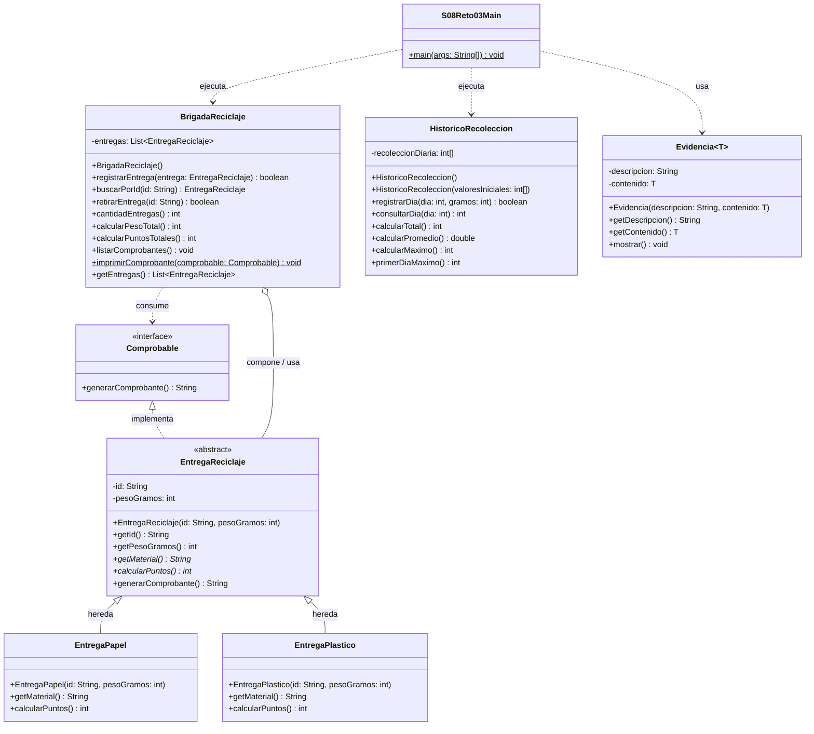

# Reto 3 · Brigada de Reciclaje Escolar
## Informe de Implementación y Guía de Sustentación

**Asignatura:** Programación Orientada a Objetos en Java  
**Sesión 8:** Arreglos, Listas y Clases Genéricas  
**Modalidad:** Trabajo Grupal / Laboratorio Evaluado  

---

## 1. Integrantes y Aportes

| Integrante | Rol / Aporte Principal |
| :--- | :--- |
| **Estudiante 1** | Modelado del dominio, jerarquía abstracta (`EntregaReciclaje`, `EntregaPapel`, `EntregaPlastico`) e interfaz `Comprobable`. |
| **Estudiante 2** | Lógica de colección dinámica (`BrigadaReciclaje` con `ArrayList<>`), validaciones de ID y normalización. |
| **Estudiante 3** | Gestión de datos históricos fijos (`HistoricoRecoleccion`), clase genérica propia (`Evidencia<T>`) y pruebas en `S08Reto03Main`. |

---

## 2. Identificación del Problema

### ¿Quién necesita la aplicación?
La **brigada de reciclaje escolar**, encargada de coordinar las jornadas de recolección de materiales reciclables (papel y plástico) aportados por la comunidad educativa.

### ¿Qué dificultad tiene?
El registro manual o informal provocaba duplicación de registros, errores en la conversión de peso a puntos (debido a que cada material posee un factor de conversión diferente y no admite sobrantes fraccionarios), y desajustes en las estadísticas globales cuando se eliminaba un registro cargado por error.

### ¿Qué debe resolver y qué queda fuera?
- **Debe resolver:**
  1. Registrar entregas de papel y plástico asignando identificadores únicos normalizados (`strip()` y `toUpperCase(Locale.ROOT)`).
  2. Validar que el peso de cada entrega esté entre 100 y 10,000 gramos inclusive.
  3. Calcular puntos automáticamente según el tipo de material mediante polimorfismo, sin estructuras de decisión condicionales (`if`/`switch`) por tipo.
  4. Permitir el retiro de entregas por ID, recalculando de forma dinámica e inmediata las cantidades, pesos y puntos vigentes sobre la lista actual.
  5. Mantener un registro histórico independiente de 5 días de recolección mediante un arreglo fijo, calculando total, promedio, máximo y primer día de mayor recolección.
  6. Encapsular conclusiones y métricas numéricas mediante una clase genérica propia (`Evidencia<T>`).
- **Queda fuera:**
  - Persistencia en base de datos o archivos físicos.
  - Conversión de puntos a dinero o canje de premios.
  - Interfaz gráfica de usuario (GUI).
  - Uso de colecciones avanzadas (`Map`, `Set`), `enum`, streams o lambdas.

### Entradas, Salidas y Reglas del Sistema
- **Entradas:** Identificador alfanumérico (ej. `"R-01"`), peso entero en gramos (100 a 10,000) y tipo de material. Para el histórico: 5 valores enteros de gramos diarios (0 a 100,000).
- **Salidas:** Comprobantes detallados por entrega (ID, material, gramos y puntos), totales recalculados (entregas activas, gramos totales, puntos totales), estadísticas del arreglo histórico y evidencias genéricas.
- **Reglas inviolables:**
  - **Papel:** Otorga 1 punto por cada 100 gramos completos (`peso / 100`). Sobrantes no dan puntos.
  - **Plástico:** Otorga 2 puntos por cada 100 gramos completos (`(peso / 100) * 2`). Sobrantes no dan puntos.
  - **IDs:** No nulos, no vacíos. Se normalizan con `strip().toUpperCase(Locale.ROOT)` tanto al registrar como al buscar. No se permiten IDs duplicados.
  - **Retiro:** Retirar un ID existente retorna `true` y recalcula totales sobre los elementos restantes; retirar un ID inexistente retorna `false` y no altera la lista.
  - **Lista vacía:** Genera totales en 0 y mensajes controlados sin lanzar excepciones.

---

## 3. Justificación del Diseño Orientado a Objetos (POO)

### Responsabilidades y Estado
- **`EntregaReciclaje` (Clase Abstracta):** Modela el estado base inmutable de toda entrega (`id` y `pesoGramos`). Obliga mediante contrato abstracto a que cada subclase defina su material (`getMaterial()`) y su fórmula de puntos (`calcularPuntos()`).
- **`EntregaPapel` y `EntregaPlastico` (Subclases Concretas):** Especializan el cálculo de puntos según su tasa específica.
- **`Comprobable` (Interfaz):** Define el contrato de generación de comprobantes (`generarComprobante()`). Permite que un cliente (`imprimirComprobante`) procese cualquier entrega sin acoplarse a su implementación concreta.
- **`BrigadaReciclaje` (Gestor):** Mantiene la colección `List<EntregaReciclaje>` y centraliza la lógica de negocio (alta sin duplicados, búsqueda lineal, eliminación y totales recalculados en tiempo real).
- **`HistoricoRecoleccion`:** Encapsula el arreglo de 5 días preservando el orden cronológico.
- **`Evidencia<T>`:** Clase genérica desacoplada de tipos específicos.

### Justificación «Es un» frente a «Usa»
- **Relación «Es un» (Herencia):** `EntregaPapel` **es una** `EntregaReciclaje`; `EntregaPlastico` **es una** `EntregaReciclaje`. Comparten atributos esenciales y un ciclo de vida idéntico, pero varían en su comportamiento matemático de puntaje.
- **Relación «Usa» (Asociación/Composición):** `BrigadaReciclaje` **usa** una `List<EntregaReciclaje>`. No hereda de la lista ni la entrega hereda de la brigada. La brigada actúa como orquestador del dominio.

### Eliminación de `if` por tipo mediante Polimorfismo
En lugar de consultar `if (entrega instanceof Papel)` o `if (tipo.equals("PAPEL"))` para calcular puntos o emitir comprobantes, el método `entrega.calcularPuntos()` se resuelve mediante **ligadura dinámica (dynamic dispatch)** en tiempo de ejecución. El código cliente desconoce la clase final y trata a todas las instancias bajo la referencia base `EntregaReciclaje` o el contrato `Comprobable`.

---

## 4. Diagrama UML de Clases



*Nota de vigencia:* El diseño inicial planificado coincide en su totalidad con el código final implementado, satisfaciendo la totalidad de los lineamientos solicitados.

---

## 5. Justificación de las Estructuras de Datos

1. **Arreglo de cinco datos fijos (`int[5]`):**
   - **Por qué se eligió:** La recolección histórica tiene una cardinalidad inmutable y predeterminada de exactamente 5 días lectivos (lunes a viernes). Un arreglo primitivo asigna un bloque de memoria contigua de tamaño fijo sin overhead de wrappers de objetos.
   - **Mapeo:** El día 1 se indexa en la posición 0, y el día 5 en la posición 4 (`indice = dia - 1`).
   - **Preservación del orden:** El arreglo **no se ordena** con `Arrays.sort()`, ya que reordenarlo destruiría la correlación cronológica de los días.
   - **Desempate:** Al buscar el máximo, se utiliza el operador estricto `>` (`if (recoleccionDiaria[i] > max)`), garantizando que si el valor máximo se repite en días posteriores, se conserve el **primer día**.

2. **Lista tipada de cantidad variable (`List<EntregaReciclaje>` con `ArrayList<>`):**
   - **Por qué se eligió:** Las entregas que llegan a la brigada no tienen un límite prefijado; pueden añadirse o retirarse dinámicamente.
   - **Por qué `ArrayList` frente a `LinkedList`:** `ArrayList` ofrece acceso en tiempo constante $O(1)$ por índice, excelente localidad espacial de caché para iteraciones secuenciales de cálculo de totales y menor consumo de memoria al no requerir nodos enlazados con punteros anterior/siguiente.
   - **Seguridad:** Los métodos devuelven copias defensivas (`new ArrayList<>(entregas)`) para impedir que agentes externos modifiquen la lista privada.

3. **Clase genérica propia (`Evidencia<T>`):**
   - **Por qué se diseñó:** Permite reutilizar la estructura de auditoría y reporte con cualquier tipo de dato (`Integer` para métricas cuantitativas, `String` para conclusiones textuales) garantizando seguridad de tipos en tiempo de compilación (*compile-time type safety*), sin recurrir a tipos crudos (*raw types*) ni a conversiones forzadas (*casting*).

---

## 6. Instrucciones de Compilación y Ejecución

### Desde la consola (Terminal Linux / macOS / Windows)
Ubicarse en la raíz del repositorio (`/home/camper/campus-java`):

```bash
# 1. Compilar todas las clases del paquete reto03 hacia la carpeta out
javac -d out/production/campus-java src/02-poo-estructuras-datos/sesion-08-arreglos-listas-genericos/labs/reto-03-brigada-reciclaje/*.java

# 2. Ejecutar la clase principal
java -cp out/production/campus-java reto03.S08Reto03Main
```

### Desde IntelliJ IDEA
1. Abrir el proyecto en IntelliJ IDEA.
2. Navegar a `src/02-poo-estructuras-datos/sesion-08-arreglos-listas-genericos/labs/reto-03-brigada-reciclaje/`.
3. Hacer clic derecho sobre `S08Reto03Main.java` y seleccionar **Run 'S08Reto03Main.main()'**.

---

## 7. Matriz de Pruebas y Validación

| # | Prueba / Escenario | Entradas | Resultado Esperado | Resultado Obtenido | ¿Coincide? |
| :---: | :--- | :--- | :--- | :--- | :---: |
| 1 | **Escenario Base:** Registro inicial | Papel `R-01` (750 g), Plástico `R-02` (450 g) | 2 entregas, 1200 g, 15 pts (Papel: 7, Plástico: 8) | 2 entregas, 1200 g, 15 pts (Papel: 7, Plástico: 8) | **SÍ** |
| 2 | **Escenario Base:** Retiro exitoso | ID `"R-01"` | Retiro: `true`, 1 entrega, 450 g, 8 pts | Retiro: `true`, 1 entrega, 450 g, 8 pts | **SÍ** |
| 3 | **Escenario Base:** Retiro duplicado | ID `"R-01"` | Retiro: `false`, conserva 1 entrega, 450 g, 8 pts | Retiro: `false`, conserva 1 entrega, 450 g, 8 pts | **SÍ** |
| 4 | **Escenario Base:** Evidencia numérica | Puntos actuales vigentes | `Evidencia<Integer>` con valor `8` | `[Evidencia] Puntos vigentes del escenario: 8` | **SÍ** |
| 5 | **Escenario Base:** Arreglo histórico | `[1200, 800, 0, 2000, 1000]` | Total: 5000 g, Promedio: 1000.0 g, Máx: 2000 g, Día: 4 | Total: 5000 g, Promedio: 1000.0 g, Máx: 2000 g, Día: 4 | **SÍ** |
| 6 | **Límite inferior:** Peso 99 g | `new EntregaPapel("LIM-01", 99)` | Lanzar excepción / Rechazado | `IllegalArgumentException: El peso debe estar entre 100 y 10000 gramos` | **SÍ** |
| 7 | **Límite superior:** Peso 10001 g | `new EntregaPlastico("LIM-02", 10001)` | Lanzar excepción / Rechazado | `IllegalArgumentException: El peso debe estar entre 100 y 10000 gramos` | **SÍ** |
| 8 | **Límite exacto:** 100 g en ambas subclases | Papel (100 g), Plástico (100 g) | Papel: 1 pt, Plástico: 2 pts | Papel: 1 pt, Plástico: 2 pts | **SÍ** |
| 9 | **ID Duplicado normalizado** | `"dup-01"` y luego `"  DUP-01  "` | Primero: `true`, Segundo: `false` | Primero: `true`, Segundo: `false` | **SÍ** |
| 10 | **Búsqueda ID existente e inexistente** | Buscar `" DUP-01 "` y `"INEXISTENTE"` | ID encontrado: `DUP-01`; Inexistente: `No encontrado` | ID encontrado: `DUP-01`; Inexistente: `No encontrado` | **SÍ** |
| 11 | **Lista vacía** | Sin entregas | Cantidad: 0, Peso: 0, Puntos: 0, Comprobantes: "Lista vacia." | Cantidad: 0, Peso: 0, Puntos: 0, "Lista vacia. Sin registros." | **SÍ** |
| 12 | **Rango fuera de arreglo** | Consultar día 6, actualizar día 0 | Rechazados (-1 y `false`) sin alterar arreglo | Rechazados sin alterar arreglo | **SÍ** |

### Explicación del Breakpoint de Depuración
- **Línea evaluada:** `BrigadaReciclaje.java`, línea 59 (`if (entregas.get(i).getId().equals(idNormalizado))`) dentro del método `retirarEntrega(String id)`.
- **Objetivo:** Verificar el estado de la lista antes y después de retirar `R-01` por segunda vez.
- **Variables observadas:**
  - **Antes de la ejecución:** `idNormalizado = "R-01"`, `entregas.size() = 1`, `entregas.get(0).getId() = "R-02"`, `i = 0`.
  - **Evaluación del condicional:** `"R-02".equals("R-01")` evalúa a `false`. El ciclo termina sin entrar al bloque `remove()`.
  - **Después de la ejecución:** La función retorna `false`. La lista conserva intacto su único elemento (`R-02`) con 450 g y 8 puntos.

---

## 8. Sustentación Línea por Línea del Código

Esta sección detalla de forma exhaustiva cada instrucción de las clases para defender el código ante el docente.

---

### A. `Comprobable.java`
```java
1: package reto03;
2: 
3: public interface Comprobable {
4:     String generarComprobante();
5: }
```
- **Línea 1:** Declara el paquete `reto03` para aislar el reto dentro del proyecto.
- **Líneas 3-5:** Define la interfaz `Comprobable`. Establece un contrato que exige que cualquier clase que lo implemente provea el método `generarComprobante()`, retornando un `String` con los datos del comprobante. No tiene estado ni atributos.

---

### B. `EntregaReciclaje.java`
```java
1: package reto03;
2: 
3: import java.util.Locale;
4: 
5: public abstract class EntregaReciclaje implements Comprobable {
6:     private final String id;
7:     private final int pesoGramos;
```
- **Línea 3:** Importa `Locale` para asegurar formateo uniforme independiente del idioma del sistema operativo.
- **Línea 5:** Declara `EntregaReciclaje` como clase abstracta e implementa `Comprobable`. Al ser abstracta, no se puede instanciar directamente con `new EntregaReciclaje(...)`, obligando a crear instancias de sus subtipos concretos.
- **Líneas 6-7:** Atributos de instancia `id` y `pesoGramos`. Son `private` para respetar el encapsulamiento y `final` para garantizar inmutabilidad una vez creados.

```java
8:     public EntregaReciclaje(String id, int pesoGramos) {
9:         if (id == null || id.strip().isEmpty()) {
10:            throw new IllegalArgumentException("El ID no puede ser nulo ni estar en blanco.");
11:        }
12:        if (pesoGramos < 100 || pesoGramos > 10000) {
13:            throw new IllegalArgumentException("El peso debe estar entre 100 y 10000 gramos. Recibido: " + pesoGramos);
14:        }
15:        this.id = id.strip().toUpperCase(Locale.ROOT);
16:        this.pesoGramos = pesoGramos;
17:    }
```
- **Línea 8:** Constructor que recibe el ID y el peso en gramos.
- **Líneas 9-11:** Valida que el ID no sea nulo ni consista únicamente de espacios en blanco. Si falla, lanza `IllegalArgumentException`.
- **Líneas 12-14:** Valida la regla de negocio del rango de peso (entre 100 y 10,000 gramos).
- **Línea 15:** Normaliza el ID: `strip()` remueve espacios al inicio y al final, y `toUpperCase(Locale.ROOT)` convierte a mayúsculas con regla cultural neutral.
- **Línea 16:** Asigna el peso en gramos al campo privado.

```java
18:    public String getId() {
19:        return id;
20:    }
21: 
22:    public int getPesoGramos() {
23:        return pesoGramos;
24:    }
25: 
26:    public abstract String getMaterial();
27:    public abstract int calcularPuntos();
```
- **Líneas 18-24:** Métodos accesores (*getters*) públicos de solo lectura.
- **Líneas 26-27:** Métodos abstractos sin cuerpo. Obligan a las subclases hijas a implementar su lógica particular para retornar el nombre del material y calcular los puntos.

```java
28:    @Override
29:    public String generarComprobante() {
30:        return String.format(Locale.ROOT, "Comprobante [ID: %s, Material: %s, Gramos: %d g, Puntos: %d]",
31:                id, getMaterial(), pesoGramos, calcularPuntos());
32:    }
33: }
```
- **Línea 28:** Anotación `@Override` que indica que se implementa el método de la interfaz `Comprobable`.
- **Líneas 29-32:** Genera la representación textual del comprobante. Invoca a `getMaterial()` y `calcularPuntos()`, los cuales se resuelven dinámicamente según la subclase real que se esté ejecutando.

---

### C. `EntregaPapel.java`
```java
1: package reto03;
2: 
3: public class EntregaPapel extends EntregaReciclaje {
4:     public EntregaPapel(String id, int pesoGramos) {
5:         super(id, pesoGramos);
6:     }
```
- **Línea 3:** Extiende de `EntregaReciclaje`.
- **Líneas 4-6:** Constructor que delega al constructor padre con `super(id, pesoGramos)` para ejecutar las validaciones y normalizaciones comunes.

```java
7:     @Override
8:     public String getMaterial() {
9:         return "Papel";
10:    }
11: 
12:    @Override
13:    public int calcularPuntos() {
14:        return (getPesoGramos() / 100) * 1;
15:    }
16: }
```
- **Líneas 8-10:** Sobrescribe `getMaterial()` retornando `"Papel"`.
- **Líneas 13-15:** Sobrescribe `calcularPuntos()`. Realiza división entera `getPesoGramos() / 100` (descartando automáticamente el residuo fraccionario) y multiplica por 1.

---

### D. `EntregaPlastico.java`
```java
1: package reto03;
2: 
3: public class EntregaPlastico extends EntregaReciclaje {
4:     public EntregaPlastico(String id, int pesoGramos) {
5:         super(id, pesoGramos);
6:     }
```
- **Línea 3:** Extiende de `EntregaReciclaje`.
- **Líneas 4-6:** Constructor que invoca a `super(...)`.

```java
7:     @Override
8:     public String getMaterial() {
9:         return "Plástico";
10:    }
11: 
12:    @Override
13:    public int calcularPuntos() {
14:        return (getPesoGramos() / 100) * 2;
15:    }
16: }
```
- **Líneas 8-10:** Retorna el nombre del material `"Plástico"`.
- **Líneas 13-15:** Calcula los puntos multiplicando cada bloque de 100 gramos completos por 2. Por ejemplo: $450 / 100 = 4 \times 2 = 8$ puntos.

---

### E. `BrigadaReciclaje.java`
```java
1: package reto03;
2: 
3: import java.util.ArrayList;
4: import java.util.List;
5: import java.util.Locale;
6: 
7: public class BrigadaReciclaje {
8:     private final List<EntregaReciclaje> entregas;
9: 
10:    public BrigadaReciclaje() {
11:        this.entregas = new ArrayList<>();
12:    }
```
- **Líneas 3-5:** Importaciones de colecciones de Java y utilidades.
- **Línea 8:** Campo privado `entregas` tipado contra la interfaz `List<EntregaReciclaje>` (principio de programar hacia interfaces, no hacia implementaciones concretas).
- **Líneas 10-12:** Constructor que inicializa la lista interna con `new ArrayList<>()`.

```java
13:    public boolean registrarEntrega(EntregaReciclaje entrega) {
14:        if (entrega == null) {
15:            return false;
16:        }
17:        String idNormalizado = entrega.getId();
18:        for (int i = 0; i < entregas.size(); i++) {
19:            if (entregas.get(i).getId().equals(idNormalizado)) {
20:                return false;
21:            }
22:        }
23:        entregas.add(entrega);
24:        return true;
25:    }
```
- **Línea 14-16:** Si la entrega recibida es `null`, se rechaza retornando `false`.
- **Línea 17:** Obtiene el ID ya normalizado de la entrega.
- **Líneas 18-22:** Ciclo `for` tradicional que recorre la lista comparando con `equals()`. Si ya existe una entrega con ese ID, retorna `false` (rechazo de duplicados).
- **Líneas 23-24:** Si no está duplicado, agrega el elemento a la lista con `entregas.add(entrega)` y retorna `true`.

```java
26:    public EntregaReciclaje buscarPorId(String id) {
27:        if (id == null || id.strip().isEmpty()) {
28:            return null;
29:        }
30:        String idNormalizado = id.strip().toUpperCase(Locale.ROOT);
31:        for (int i = 0; i < entregas.size(); i++) {
32:            EntregaReciclaje entrega = entregas.get(i);
33:            if (entrega.getId().equals(idNormalizado)) {
34:                return entrega;
35:            }
36:        }
37:        return null;
38:    }
```
- **Líneas 27-29:** Si el ID consultado es nulo o vacío, retorna `null`.
- **Línea 30:** Aplica la normalización requerida (`strip()` y `toUpperCase(Locale.ROOT)`).
- **Líneas 31-36:** Recorre la lista; si encuentra coincidencia exacta, retorna la referencia al objeto.
- **Línea 37:** Si termina el ciclo sin coincidencias, retorna `null`.

```java
39:    public boolean retirarEntrega(String id) {
40:        if (id == null || id.strip().isEmpty()) {
41:            return false;
42:        }
43:        String idNormalizado = id.strip().toUpperCase(Locale.ROOT);
44:        for (int i = 0; i < entregas.size(); i++) {
45:            if (entregas.get(i).getId().equals(idNormalizado)) {
46:                entregas.remove(i);
47:                return true;
48:            }
49:        }
50:        return false;
51:    }
```
- **Líneas 40-43:** Valida y normaliza el ID a retirar.
- **Líneas 44-49:** Busca la posición del elemento. Si lo encuentra, lo elimina con `entregas.remove(i)` y retorna `true`.
- **Líneas 50-51:** Si no existía, retorna `false` conservando el estado intacto de la lista.

```java
52:    public int cantidadEntregas() {
53:        return entregas.size();
54:    }
55: 
56:    public int calcularPesoTotal() {
57:        int total = 0;
58:        for (int i = 0; i < entregas.size(); i++) {
59:            total += entregas.get(i).getPesoGramos();
60:        }
61:        return total;
62:    }
63: 
64:    public int calcularPuntosTotales() {
65:        int total = 0;
66:        for (int i = 0; i < entregas.size(); i++) {
67:            total += entregas.get(i).calcularPuntos();
68:        }
69:        return total;
70:    }
```
- **Línea 53:** Retorna la cantidad de elementos vigentes en la lista mediante `size()`.
- **Líneas 56-62:** Acumula y retorna el peso en gramos de las entregas que permanecen activas.
- **Líneas 64-70:** Acumula y retorna la suma polimórfica de puntos de las entregas vigentes. Al no conservar variables acumuladoras históricas, cualquier entrega retirada deja de sumar de forma automática.

```java
71:    public void listarComprobantes() {
72:        if (entregas.isEmpty()) {
73:            System.out.println("Lista vacia. Sin registros.");
74:            return;
75:        }
76:        for (int i = 0; i < entregas.size(); i++) {
77:            imprimirComprobante(entregas.get(i));
78:        }
79:    }
80: 
81:    public static void imprimirComprobante(Comprobable comprobable) {
82:        if (comprobable != null) {
83:            System.out.println(comprobable.generarComprobante());
84:        }
85:    }
86: 
87:    public List<EntregaReciclaje> getEntregas() {
88:        return new ArrayList<>(entregas);
89:    }
90: }
```
- **Líneas 72-75:** Verifica si la lista está vacía e imprime el mensaje correspondiente.
- **Líneas 76-78:** Recorre la lista e invoca el cliente de comprobantes.
- **Líneas 81-85:** Método cliente desacoplado. Recibe una referencia de tipo `Comprobable` y ejecuta su método `generarComprobante()` sin saber si es papel o plástico.
- **Líneas 87-89:** Retorna una copia defensiva (`new ArrayList<>(entregas)`), preservando el encapsulamiento.

---

### F. `HistoricoRecoleccion.java`
```java
1: package reto03;
2: 
3: public class HistoricoRecoleccion {
4:     private final int[] recoleccionDiaria;
5: 
6:     public HistoricoRecoleccion() {
7:         this.recoleccionDiaria = new int[5];
8:     }
9: 
10:    public HistoricoRecoleccion(int[] valoresIniciales) {
11:        this();
12:        if (valoresIniciales != null && valoresIniciales.length == 5) {
13:            for (int i = 0; i < 5; i++) {
14:                if (valoresIniciales[i] >= 0 && valoresIniciales[i] <= 100000) {
15:                    this.recoleccionDiaria[i] = valoresIniciales[i];
16:                }
17:            }
18:        }
19:    }
```
- **Línea 4:** Arreglo primitivo `int[]` de tamaño fijo.
- **Líneas 6-8:** Constructor por defecto que inicializa el arreglo con 5 posiciones en cero.
- **Líneas 10-19:** Constructor sobrecargado que recibe un arreglo de 5 elementos validando que cada valor se encuentre en el rango permitido (0 a 100,000 g).

```java
20:    public boolean registrarDia(int dia, int gramos) {
21:        int indice = dia - 1;
22:        if (indice < 0 || indice >= recoleccionDiaria.length) {
23:            return false;
24:        }
25:        if (gramos < 0 || gramos > 100000) {
26:            return false;
27:        }
28:        recoleccionDiaria[indice] = gramos;
29:        return true;
30:    }
31: 
32:    public int consultarDia(int dia) {
33:        int indice = dia - 1;
34:        if (indice < 0 || indice >= recoleccionDiaria.length) {
35:            return -1;
36:        }
37:        return recoleccionDiaria[indice];
38:    }
```
- **Líneas 21-30:** Registra un día (1 a 5). Mapea a índice 0 a 4 (`dia - 1`). Valida los límites del índice y el rango de gramos antes de escribir; si no cumple, retorna `false`.
- **Líneas 32-38:** Consulta los gramos de un día. Si está fuera de rango, retorna `-1`.

```java
39:    public int calcularTotal() {
40:        int total = 0;
41:        for (int i = 0; i < recoleccionDiaria.length; i++) {
42:            total += recoleccionDiaria[i];
43:        }
44:        return total;
45:    }
46: 
47:    public double calcularPromedio() {
48:        if (recoleccionDiaria.length == 0) {
49:            return 0.0;
50:        }
51:        return (double) calcularTotal() / recoleccionDiaria.length;
52:    }
53: 
54:    public int calcularMaximo() {
55:        int max = recoleccionDiaria[0];
56:        for (int i = 1; i < recoleccionDiaria.length; i++) {
57:            if (recoleccionDiaria[i] > max) {
58:                max = recoleccionDiaria[i];
59:            }
60:        }
61:        return max;
62:    }
63: 
64:    public int primerDiaMaximo() {
65:        int max = recoleccionDiaria[0];
66:        int diaMax = 1;
67:        for (int i = 1; i < recoleccionDiaria.length; i++) {
68:            if (recoleccionDiaria[i] > max) {
69:                max = recoleccionDiaria[i];
70:                diaMax = i + 1;
71:            }
72:        }
73:        return diaMax;
74:    }
75: }
```
- **Líneas 39-45:** Suma todos los elementos del arreglo.
- **Líneas 47-52:** Calcula el promedio. Hace un cast explícito `(double)` para evitar división truncada de enteros.
- **Líneas 54-62:** Encuentra el valor máximo recorriendo con `for`.
- **Líneas 64-74:** Localiza el **primer día** del máximo. El condicional `recoleccionDiaria[i] > max` asegura que si un día posterior empata con el valor máximo, no se sobrescriba `diaMax`.

---

### G. `Evidencia.java`
```java
1: package reto03;
2: 
3: public class Evidencia<T> {
4:     private final String descripcion;
5:     private final T contenido;
6: 
7:     public Evidencia(String descripcion, T contenido) {
8:         if (descripcion == null || descripcion.strip().isEmpty()) {
9:             throw new IllegalArgumentException("La descripción no puede ser nula ni estar en blanco.");
10:        }
11:        if (contenido == null) {
12:            throw new IllegalArgumentException("El contenido de la evidencia no puede ser nulo.");
13:        }
14:        this.descripcion = descripcion.strip();
15:        this.contenido = contenido;
16:    }
17: 
18:    public String getDescripcion() { return descripcion; }
19:    public T getContenido() { return contenido; }
20: 
21:    public void mostrar() {
22:        System.out.println("[Evidencia] " + descripcion + ": " + contenido);
23:    }
24: }
```
- **Línea 3:** Declara la clase genérica con parámetro `<T>`.
- **Líneas 4-5:** Campos privados para almacenar la descripción textual y el contenido de tipo genérico `T`.
- **Líneas 7-16:** Constructor que valida que los datos no sean nulos.
- **Líneas 18-19:** Accesores con tipado exacto `T` sin requerir casts en el cliente.
- **Líneas 21-23:** Imprime la evidencia en consola.

---

### H. `S08Reto03Main.java`
```java
1: package reto03;
2: 
3: import java.util.Locale;
4: 
5: public class S08Reto03Main {
6:     public static void main(String[] args) {
...
13:        BrigadaReciclaje brigada = new BrigadaReciclaje();
14: 
15:        EntregaReciclaje entrega1 = new EntregaPapel("R-01", 750);
16:        EntregaReciclaje entrega2 = new EntregaPlastico("R-02", 450);
17: 
18:        brigada.registrarEntrega(entrega1);
19:        brigada.registrarEntrega(entrega2);
```
- **Líneas 13-19:** Instancia el gestor `BrigadaReciclaje` y crea las dos entregas del escenario base bajo referencias abstractas `EntregaReciclaje`. Las registra en la lista.

```java
21:        System.out.println("\n--- ESTADO ANTES DE RETIRAR ---");
22:        System.out.println("Entregas: " + brigada.cantidadEntregas());
23:        System.out.println("Peso total: " + brigada.calcularPesoTotal() + " g");
24:        System.out.println("Puntos totales: " + brigada.calcularPuntosTotales() +
25:                " (papel: " + entrega1.calcularPuntos() + ", plastico: " + entrega2.calcularPuntos() + ")");
26:        System.out.println("Comprobantes vigentes:");
27:        brigada.listarComprobantes();
```
- **Líneas 21-27:** Muestra el estado inicial antes de retirar: 2 entregas, 1200 g y 15 puntos (7 de papel y 8 de plástico).

```java
29:        boolean retiro1 = brigada.retirarEntrega("R-01");
30:        System.out.println("\n--- RETIRAR R-01 (PRIMERA VEZ) ---");
31:        System.out.println("Operacion aceptada: " + retiro1);
32:        System.out.println("Entregas: " + brigada.cantidadEntregas());
33:        System.out.println("Peso total: " + brigada.calcularPesoTotal() + " g");
34:        System.out.println("Puntos totales: " + brigada.calcularPuntosTotales());
35:        System.out.println("Comprobantes vigentes tras retiro:");
36:        brigada.listarComprobantes();
```
- **Líneas 29-36:** Retira `R-01`. La operación retorna `true`. Comprueba que la lista pasa a tener 1 entrega, 450 g y 8 puntos.

```java
38:        boolean retiro2 = brigada.retirarEntrega("R-01");
39:        System.out.println("\n--- RETIRAR R-01 (SEGUNDA VEZ) ---");
40:        System.out.println("Operacion aceptada: " + retiro2);
41:        System.out.println("Entregas: " + brigada.cantidadEntregas());
42:        System.out.println("Peso total: " + brigada.calcularPesoTotal() + " g");
43:        System.out.println("Puntos totales: " + brigada.calcularPuntosTotales());
```
- **Líneas 38-43:** Intenta retirar nuevamente `R-01`. La operación retorna `false` (rechazada) y conserva intactos los 450 g y 8 puntos.

```java
45:        System.out.println("\n--- EVIDENCIAS GENERICAS ---");
46:        Evidencia<Integer> evidenciaPuntos = new Evidencia<>("Puntos vigentes del escenario", brigada.calcularPuntosTotales());
47:        Evidencia<String> evidenciaConclusion = new Evidencia<>("Conclusion del reto",
48:                "Las entregas retiradas se excluyen correctamente de los totales y los puntos se recalculan.");
49: 
50:        evidenciaPuntos.mostrar();
51:        evidenciaConclusion.mostrar();
```
- **Líneas 45-51:** Crea dos evidencias genéricas: una con `Integer` (valor 8) y otra con `String`, mostrando ambas.

```java
53:        System.out.println("\n--- ARREGLO DE CINCO DIAS (HISTORICO) ---");
54:        int[] datosArreglo = {1200, 800, 0, 2000, 1000};
55:        HistoricoRecoleccion historico = new HistoricoRecoleccion(datosArreglo);
56: 
57:        System.out.println("Total: " + historico.calcularTotal() + " g");
58:        System.out.println(String.format(Locale.ROOT, "Promedio: %.1f g", historico.calcularPromedio()));
59:        System.out.println("Maximo: " + historico.calcularMaximo() + " g");
60:        System.out.println("Dia del maximo: " + historico.primerDiaMaximo());
```
- **Líneas 53-60:** Instancia `HistoricoRecoleccion` con los datos del enunciado `[1200, 800, 0, 2000, 1000]` y muestra: Total 5000 g, Promedio 1000.0 g, Máximo 2000 g y Día 4.

```java
62-108:   // Pruebas Adicionales: límites de peso (99, 10001, 100, 10000), ID duplicado
          // normalizado, búsquedas exitosas/fallidas, lista vacía y límites de arreglo.
```
- **Líneas 62-108:** Ejecuta las pruebas complementarias para verificar robustez frente a errores y casos borde.
