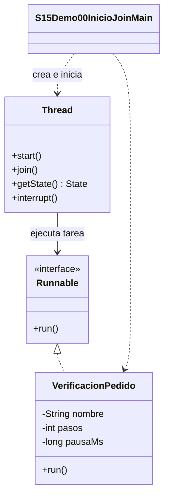

# Demo 00 · Inicio y finalización de hilos · 10 minutos

**Problema:** mientras un pedido consulta inventario, otra tarea independiente puede verificar su dirección. Ejecutarlas una detrás de otra obliga a esperar; con hilos pueden avanzar durante el mismo período.

## Orden de lectura y demostración

1. Lee [VerificacionPedido.java](VerificacionPedido.java): implementa Runnable; su run contiene la tarea y sus pasos. Cada instancia conserva sus propios datos.
2. Abre [S15Demo00InicioJoinMain.java](S15Demo00InicioJoinMain.java). La llamada directa.run es una llamada normal: se ejecuta en el hilo actual, normalmente main.
3. Localiza los dos new Thread. Crear los objetos no los inicia: antes de start ambos tienen estado NEW.
4. Ejecuta **Run → S15Demo00InicioJoinMain**. Los dos start aparecen antes de los join. Inventario y dirección pueden intercalarse, pero los pasos de cada tarea mantienen su orden.
5. Después de ambos join se muestran TERMINATED y el mensaje final. join espera terminación; no garantiza que el trabajo haya tenido éxito. Aquí las tareas también imprimen terminada o cancelada.
6. Para observarlo en Debug, coloca un breakpoint en run y consulta el panel Threads. La pausa cambia la planificación: no uses Debug para medir velocidad.

## UML de clases



## Una salida posible

```text
Hilo actual: main
Directa paso 1 en main
Directa: terminada
Antes de start: NEW / NEW
Inventario paso 1 en inventario
Direccion paso 1 en direccion
Inventario paso 2 en inventario
Direccion paso 2 en direccion
Inventario: terminada
Direccion: terminada
Despues de join: TERMINATED / TERMINATED
Fin: ambas verificaciones terminaron
```

**Qué permanece fijo:** la llamada directa usa el hilo llamador; Inventario1 precede Inventario2 y Direccion1 precede Direccion2; el cierre sigue a ambas tareas. **Qué puede variar:** el orden relativo de inventario y dirección. Dos ejecuciones pueden mostrar el mismo orden y eso es válido.

sleep(20) solo simula espera dentro de cada tarea. No coordina las tareas ni garantiza tiempo exacto, simultaneidad o mejora de rendimiento. Los nombres e IDs de hilos no definen su prioridad de ejecución. Un mismo Thread solo admite un start.

**Cuándo evitarlo:** una operación pequeña, inmediata o dependiente de la anterior puede ser más clara de forma secuencial. Dos hilos no vuelven independientes tareas que necesitan resultados entre sí.

[Volver a la sesión](../../README.md)
