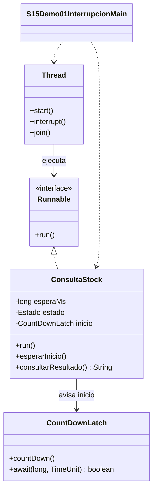

# Demo 01 · Cancelación cooperativa · 8 minutos

**Problema:** el usuario cancela un pedido mientras se consulta stock. No debemos dejar que una consulta cancelada anuncie éxito ni detener su hilo de forma forzada.

## Orden de lectura y demostración

1. Abre [ConsultaStock.java](ConsultaStock.java). Identifica run, el sleep que simula latencia y el catch de InterruptedException.
2. Abre [S15Demo01InterrupcionMain.java](S15Demo01InterrupcionMain.java). Ejecuta **Run → S15Demo01InterrupcionMain**: el primer caso termina normalmente y el segundo solicita cancelación.
3. Sigue la secuencia del segundo caso: start → esperarInicio → interrupt → join → leer resultado. El resultado pertenece a la tarea y main lo consulta después de su terminación.
4. En run, observa la comprobación de isInterrupted antes y después de sleep. Si la señal llega antes de dormir se detecta; si llega durante sleep, este lanza InterruptedException y limpia la marca. El catch la restaura y la tarea sale como CANCELADA.
5. Opcionalmente coloca un breakpoint en el catch. Suspende solo el hilo trabajador si el IDE lo permite; detener todos los hilos altera la coordinación.

## UML de clases



## Salida esperada en ejecución normal

```text
normal: COMPLETADA
Vivo tras join: false
cancelada: CANCELADA
Vivo tras join: false
Fin: consultas terminadas
```

**Detalle de apoyo:** CountDownLatch comunica que la tarea alcanzó su punto de consulta, sin esperar activamente ni dormir un tiempo arbitrario en main para intentar acertar. Está preparado; no necesitas implementar el mecanismo en los labs.

La consulta normal simula 50 ms y la cancelable hasta 5000 ms. main solicita interrupción al recibir la señal de inicio. No se evalúan duraciones exactas. Si se detiene main durante más tiempo que toda la consulta (por ejemplo, con un breakpoint), la tarea podría completar antes de recibir la señal: una cancelación tardía no revierte trabajo terminado.

**Regla:** interrupt solicita cooperación; no mata automáticamente el hilo. sleep espera tiempo; join espera terminación. No usar Thread.stop ni capturar y continuar como si nada.

El enum es el estado de negocio de la consulta, no Thread.State. El trabajador es el único que lo modifica; main solo lo lee después de join, sin sondear progreso ni usar un contador compartido.

**Costo y límite:** cancelar exige definir puntos de comprobación y salida. No aporta valor crear un hilo para un trabajo trivial que no requiere ejecución independiente.

[Volver a la sesión](../../README.md)
