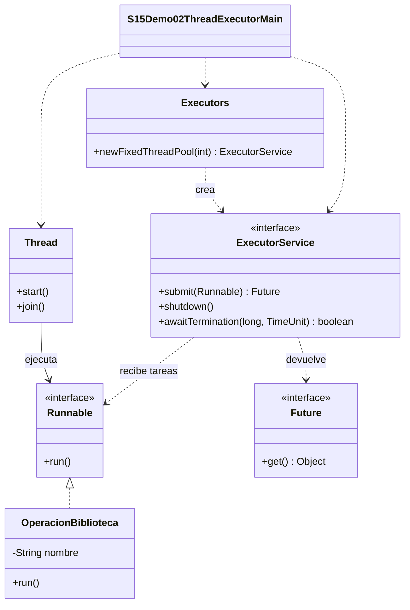

# Demo 02 · La misma tarea con Thread y ExecutorService · 8 minutos

**Evolución del lab de biblioteca:** mantenemos las tareas Runnable y cambiamos quién administra su ejecución. Validar datos del préstamo, preparar un borrador de aviso y consultar el catálogo son simulaciones independientes; no se envía una confirmación antes de aprobar el préstamo.

**Problema:** ¿debemos crear y administrar un hilo nuevo por cada operación?

Abre [S15Demo02ThreadExecutorMain.java](S15Demo02ThreadExecutorMain.java). Ejecuta **Run → S15Demo02ThreadExecutorMain**.

## Qué comparar

1. Lee [OperacionBiblioteca.java](OperacionBiblioteca.java): implementa Runnable y solo describe el trabajo. Su run imprime la operación y el hilo que lo atendió.
2. En ejecutarConThread, cada vuelta crea un Thread nuevo. Los tres hilos manual-1 a manual-3 se inician antes del recorrido de join.
3. En ejecutarConExecutor, observa `Executors.newFixedThreadPool(2)`: el ejecutor administra hasta dos trabajadores y recibe las mismas tres tareas mediante submit. Cuando los dos están ocupados, las demás esperan en la cola.
4. Ejecuta y separa los dos bloques de consola. Cada operacion aparece una vez por bloque. En el primero verás tres nombres manuales diferentes; en el segundo, como máximo dos nombres de trabajadores del pool. Un trabajador puede atender varias operaciones.
5. Coloca un breakpoint en run y usa el panel Threads de IntelliJ para identificar al ejecutor de la tarea. La depuración cambia la planificación: no esperes siempre la misma distribución.
6. Compara join con Future.get: el primero espera al hilo; el segundo espera a la tarea y permite conocer su fallo. shutdown deja terminar lo enviado y rechaza nuevos trabajos; awaitTermination comprueba el cierre del servicio.

## Diagrama de clases



## Una salida posible

```text
=== Thread: un hilo nuevo por tarea ===
Validar datos del prestamo atendido por manual-1
Preparar borrador de aviso atendido por manual-2
Consultar catalogo atendido por manual-3
=== Executor: pool de 2 hilos ===
Validar datos del prestamo atendido por pool-1-thread-1
Preparar borrador de aviso atendido por pool-1-thread-2
Consultar catalogo atendido por pool-1-thread-1
Fin: todas las tareas terminaron
```

**El orden y el reparto del segundo bloque pueden variar.** No es obligatorio que ambos trabajadores impriman: con tareas tan cortas uno puede ejecutar todo. El prefijo numérico del pool tampoco es un contrato del ejercicio. La garantía es un límite de dos trabajadores y finalización de todas las tareas antes del cierre.

**Idea clave:** Thread representa un hilo; ExecutorService administra la ejecución de tareas usando hilos. El pool reutiliza trabajadores: no crea dos hilos nuevos por tarea ni ejecuta obligatoriamente dos tareas al mismo instante. No se mide velocidad ni se promete paralelismo.

**Costo y límite:** gestionar un pool requiere cierre y manejo de fallos; su cola no está acotada en esta fábrica. Tres tareas finitas bastan aquí. Para un único trabajo sencillo, un Thread puede ser suficiente. No compartimos estado mutable entre tareas.

Código compatible con Java 17 y 21, sin lambdas ni APIs preview. ExecutionException se propaga desde main para que un fallo no se presente como éxito. El cierre de emergencia conserva las excepciones; las tareas de este ejemplo son finitas y no bloqueantes.
