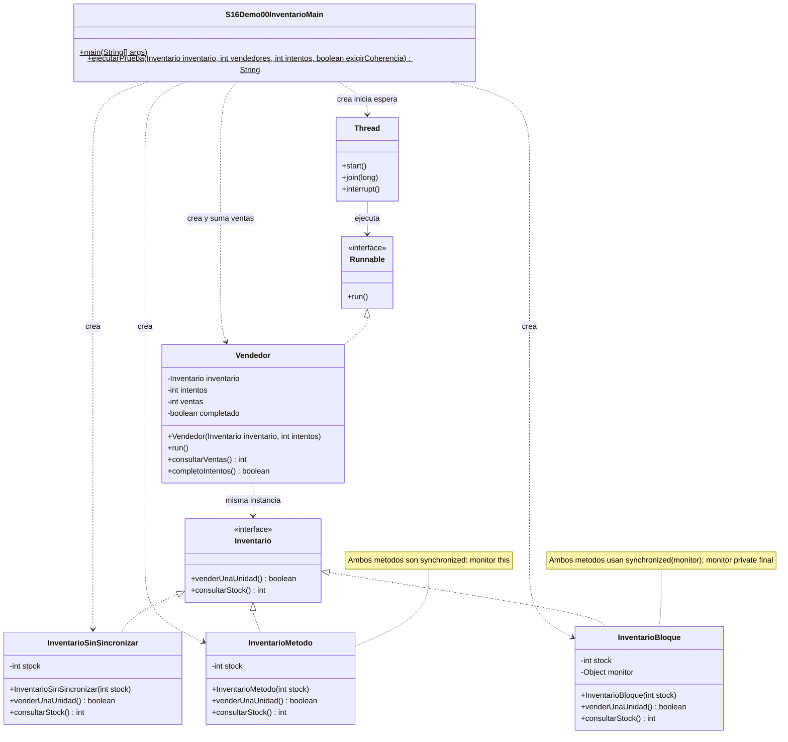
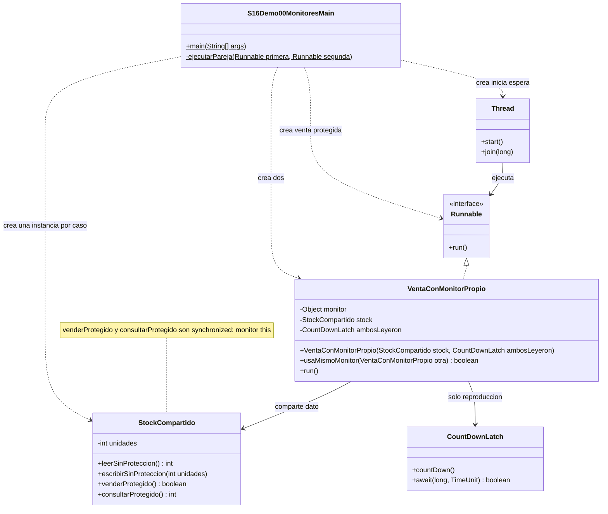
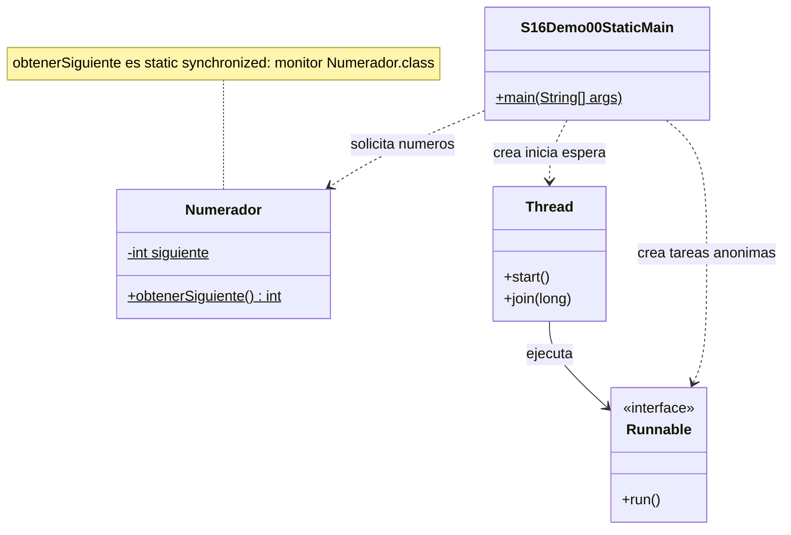

# Demo 00 · synchronized en tres ejemplos independientes · 28 minutos

Cada carpeta contiene todas las clases propias que necesita. Los hilos se crean con new Thread, se inician con start y se esperan con join **en el Main del propio ejemplo**. No hay carpeta de apoyo ni importaciones de los otros ejemplos.

| Orden | Ejemplo | Main | Tiempo |
| --- | --- | --- | ---: |
| 00-1 | Inventario sin protección, método y bloque synchronized | [S16Demo00InventarioMain](demo00_1/S16Demo00InventarioMain.java) | 18 min |
| 00-2 | Monitores distintos frente al mismo monitor | [S16Demo00MonitoresMain](demo00_2/S16Demo00MonitoresMain.java) | 7 min |
| 00-3 | static synchronized | [S16Demo00StaticMain](demo00_3/S16Demo00StaticMain.java) | 3 min |

Los nombres de las carpetas usan guion bajo para formar paquetes Java válidos. Puedes compilar cada carpeta por separado, conservando su paquete. Los diagramas muestran todas sus clases/interfaces locales; Thread y Runnable pertenecen al JDK.

## Demo 00-1 · Inventario progresivo

**Carpeta:** demo00_1 · **Paquete:** s16demo00.demo00_1.

Una tienda tiene 100 computadores; dos vendedores venden una unidad cada uno. Deben quedar 98. Si ambos leen 100 y escriben 99, se pierde una actualización.

### Cómo explicarlo

1. Lee [Inventario.java](demo00_1/Inventario.java) y [Vendedor.java](demo00_1/Vendedor.java). Cada vendedor recibe la misma referencia de inventario y conserva su propio número de ventas.
2. Compara [InventarioSinSincronizar](demo00_1/InventarioSinSincronizar.java), [InventarioMetodo](demo00_1/InventarioMetodo.java) e [InventarioBloque](demo00_1/InventarioBloque.java). La operación es la misma: comprobar disponibilidad y descontar.
3. En el método synchronized el monitor es this. En el bloque es el objeto privado y estable monitor. Tanto la comprobación como el descuento deben quedar dentro.
4. Abre el Main. Su método ejecutarPrueba crea vendedores e hilos, inicia todos y después hace join. Finalmente suma ventas y verifica el stock.
5. Ejecuta **Run → S16Demo00InventarioMain** y compara los tres casos. No necesitas abrir otra carpeta para seguir la ejecución.

| Caso | Stock inicial | Vendedores × intentos | Stock final correcto | Ventas | Rechazos |
| --- | ---: | ---: | ---: | ---: | ---: |
| Pequeño | 100 | 2 × 1 | 98 | 2 | 0 |
| Carga, tres repeticiones | 10000 | 4 × 1000 | 6000 | 4000 | 0 |
| Agotamiento | 100 | 2 × 80 | 0 | 100 | 60 |

Método y bloque deben imprimir coherente=true. Se verifica stockInicial = ventas + stockFinal, sin negativos ni sobreventa.

La versión sin protección informa lo observado: puede coincidir o mostrar pérdida. **No es obligatorio que falle cada vez.** No se usa sleep ni una impresión interna para coordinar. La secuencia start → join no protege las ventas; solo permite iniciarlas y revisar su resultado al terminar.

### UML · Las seis clases/interfaces de 00-1



Para observarlo en Debug, coloca un breakpoint en venderUnaUnidad y localiza la instancia compartida. La pausa modifica la planificación; no midas rendimiento ni exijas una carrera espontánea.

## Demo 00-2 · Monitores distintos

**Carpeta:** demo00_2 · **Paquete:** s16demo00.demo00_2.

Aquí se estudia por qué no basta con escribir synchronized si cada vendedor bloquea un objeto diferente.

### Cómo explicarlo

1. Lee [StockCompartido.java](demo00_2/StockCompartido.java). Tiene accesos sin protección para el caso defectuoso y métodos synchronized para el contraste.
2. Lee [VentaConMonitorPropio.java](demo00_2/VentaConMonitorPropio.java). Dos vendedores comparten stock, pero cada uno crea su propio monitor.
3. Ejecuta el Main: la primera parte dirige dos lecturas de 100 antes de permitir que ambos escriban 99. El CountDownLatch solo reproduce la intercalación; no es una solución al inventario.
4. La segunda parte crea **otro StockCompartido**, sin reutilizar el dato defectuoso. Dos hilos llaman venderProtegido sobre esa misma instancia; ambos adquieren su monitor this.
5. Sigue ejecutarPareja en el Main: crea los dos Thread, los inicia y espera con join. No importa ninguna clase del ejemplo 00-1.

```text
Mismo monitor: false
Intercalacion dirigida: esperado=98 observado=99
Monitor compartido: esperado=98 observado=98
```

Los accesos sin protección son deliberadamente defectuosos y no se mezclan con los protegidos sobre la misma instancia. Un método synchronized **no impide que otro código acceda sin usar ese monitor**.

No coloques la espera de ambas lecturas dentro de un único monitor compartido: el primer hilo esperaría al segundo, que no podría entrar. No se afirma que toda ejecución natural de la versión defectuosa deje 99.

### UML · Las tres clases de 00-2



## Demo 00-3 · static synchronized

**Carpeta:** demo00_3 · **Paquete:** s16demo00.demo00_3.

1. Lee [Numerador.java](demo00_3/Numerador.java). obtenerSiguiente es static synchronized.
2. En el Main, observa la creación de dos Thread. Las tareas escriben en posiciones distintas del arreglo; main revisa esos resultados después de los join.
3. Ejecuta el Main y comprueba dos identificadores distintos, sin exigir qué trabajador recibe cada número.
4. Compara: método synchronized de instancia usa this; static synchronized usa Numerador.class. Esos monitores no coordinan automáticamente entre sí.

```text
Identificadores distintos: 2
Monitor: Numerador.class
```

### UML · Las dos clases de 00-3



Es un ejemplo breve, sin laboratorio adicional. El objeto Class corresponde a esa clase y su cargador; no es un bloqueo global de toda la JVM.

## Cierre

Cada Main conserva espera con plazo y limpieza de hilos. Las comprobaciones extensas se ejecutan aparte para validar el material, sin una clase de apoyo compartida en estos ejemplos.

El [Lab 00](../../labs/s16lab00/README.md) es una actividad distinta, con Cupos y Participante y su propio diagrama.

> synchronized no protege mágicamente una variable. Coordina la ejecución de los hilos que utilizan el mismo monitor.

[Volver a la sesión](../../README.md)
