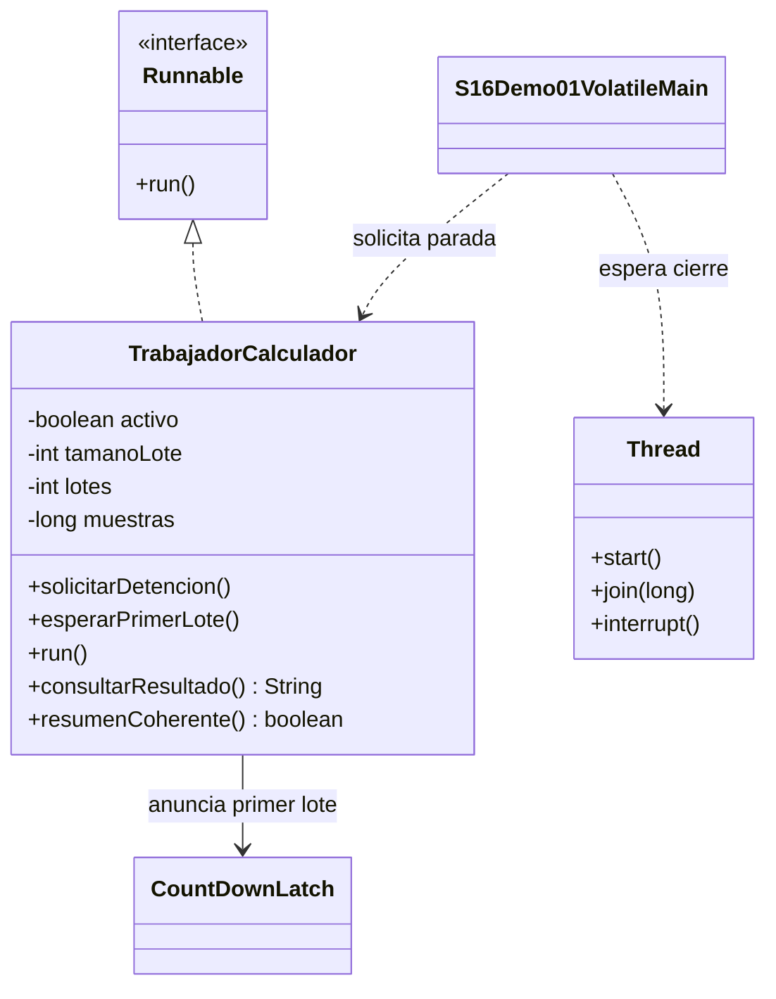

# Demo 01 · volatile boolean para solicitar parada · 12 minutos

**Problema:** un trabajador realiza lotes de cálculo y otro hilo solicita detenerlo. La pregunta es de **visibilidad**: ¿observa el trabajador el cambio de la bandera?

## Orden de lectura

1. Abre [TrabajadorCalculador.java](TrabajadorCalculador.java). Localiza private volatile boolean activo = true y solicitarDetencion, que escribe false.
2. Lee run: antes de cada lote comprueba activo; si recibe la señal, sale con DETENIDO_POR_BANDERA. El lote realiza una suma verificable, no una espera vacía.
3. Abre [S16Demo01VolatileMain.java](S16Demo01VolatileMain.java). Main inicia, espera que se haya completado al menos un lote, escribe la bandera y espera con join.
4. Ejecuta **Run → S16Demo01VolatileMain**. Observa que termina y conserva un resumen consistente.
5. En Debug, coloca un breakpoint en solicitarDetencion y luego en la rama !activo de run. Suspende solo el hilo pertinente si el IDE lo permite. No uses tiempos exactos como criterio.

## Resultado esperado

```text
Resultado: DETENIDO_POR_BANDERA
Lotes completos: N
Resumen coherente: true
Hilo vivo: false
```

N es un número variable, al menos 1 en esta ejecución. **No escribas literalmente N como resultado del programa.** La cantidad depende de la planificación; la validación compara muestras y suma calculada con los lotes completos, no con un conteo fijo.

Hay un límite de seguridad de 1000000 lotes. Si se alcanza antes de la petición (por ejemplo, main detenido en Debug), imprime LIMITE_DE_SEGURIDAD y No concluyente. Eso no se presenta como prueba de parada por volatile; repite normalmente sin esas pausas.

## Qué comunica cada mecanismo

- CountDownLatch anuncia el primer lote **del trabajador hacia main**; no envía la petición de parada.
- La escritura de activo=false y su lectura volatile comunican la petición **de main hacia el trabajador**.
- join espera terminación y permite leer el resumen después. No es el mecanismo por el que el trabajador recibe la petición mientras trabaja.
- El interrupt de finally es solo limpieza de emergencia; un resultado INTERRUMPIDO_EN_LIMPIEZA no cuenta como demostración de parada por bandera.

No hay println, sleep o bloqueos en cada iteración. Los conteos y la suma pertenecen solo al trabajador; main los consulta después de join.

## UML



La propiedad activo es **volatile** en Java; el diagrama muestra su tipo y la explicación precisa el modificador.

**Idea clave:** volatile no es un bloqueo ni hace atómicas varias instrucciones. Sirve aquí para una señal simple. No vuelve seguro contador++ ni despierta por sí solo a un hilo que espera una operación bloqueante.

**Costo y límite:** la parada se atiende entre lotes; un lote grande retrasa la respuesta. Para un trabajo bloqueado en una API interrumpible, valora interrupt. No quitar volatile como ejercicio que deba “fallar siempre”: una versión defectuosa podría aparentar funcionar.

[Volver a la sesión](../../README.md)
