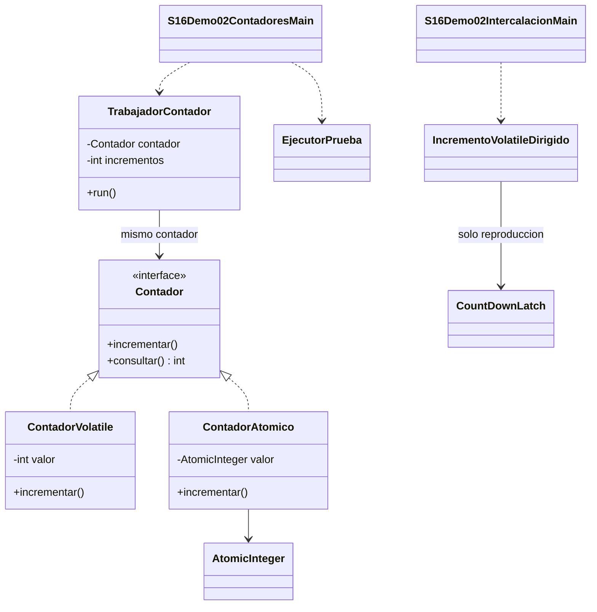

# Demo 02 · volatile int frente a AtomicInteger · 15 minutos

**Problema:** diez hilos completan 100 incrementos cada uno. El total esperado es 1000, pero valor++ no es una única acción indivisible: conceptualmente lee, calcula y escribe.

## Comparar la misma carga

1. Lee [Contador.java](Contador.java), [ContadorVolatile.java](ContadorVolatile.java) y [ContadorAtomico.java](ContadorAtomico.java). Ambos parten de cero; la diferencia está en incrementar.
2. En volatile, valor++ sigue siendo una operación compuesta. En AtomicInteger, incrementAndGet incrementa de forma atómica.
3. Abre [TrabajadorContador.java](TrabajadorContador.java) y [S16Demo02ContadoresMain.java](S16Demo02ContadoresMain.java). Cada tarea ejecuta un número fijo de incrementos; no hay println dentro del incremento.
4. Ejecuta **Run → S16Demo02ContadoresMain**. Hay tres intentos, con contadores nuevos. EjecutorPrueba inicia y espera tareas y comunica sus fallos.
5. Compara observado con 1000. AtomicInteger debe dar1000; volatile puede coincidir o perder actualizaciones. Si coincide, esa ejecución no demuestra atomicidad.
6. Observa el ejemplo secuencial final: distingue el valor retornado del valor almacenado.

## Resultados

Las primeras líneas tienen esta forma, con V variable:

```text
Prueba 1: esperado=1000 volatile=V atomico=1000
Prueba 2: esperado=1000 volatile=V atomico=1000
Prueba 3: esperado=1000 volatile=V atomico=1000
incrementAndGet devuelve: 1
getAndIncrement devuelve: 1
Valor actual: 2
addAndGet(3) devuelve: 5
```

V no es texto literal ni un error obligatorio. No repetir indefinidamente hasta ver un fallo ni presentar una ejecución correcta como garantía.

## Reproducción dirigida de la pérdida

Ejecuta [S16Demo02IntercalacionMain.java](S16Demo02IntercalacionMain.java) y lee [IncrementoVolatileDirigido.java](IncrementoVolatileDirigido.java).

```text
Incremento desglosado dirigido: esperado=2 observado=1
```

Dos tareas leen 0; un apoyo espera ambas lecturas y permite que ambas escriban 1. Volatile garantiza las lecturas/escrituras de ese campo, pero no fusiona la secuencia completa. Este es un **incremento desglosado instrumentado**, separado del estrés natural de valor++; no se afirma que toda ejecución de ++ pierda actualizaciones.

## UML



El valor de ContadorVolatile lleva el modificador volatile en Java. No es equivalente a la operación atómica del otro contador.

## Límites y comparación

AtomicInteger protege **sus operaciones individuales**. Hacer get(), comprobar >0 y luego decrementAndGet() son varias llamadas: no vuelve seguro el inventario ni protege otros campos. Para una regla compuesta, usa una sección crítica coherente o una estrategia atómica diseñada expresamente; no añadir loops CAS en esta introducción.

En Debug sigue incrementar de ambas clases, pero no esperes reproducir una carrera natural: la depuración modifica la planificación. La prueba dirigida permite razonar sin exigir ese azar.

**Cuándo usarlo:** contador entero compartido con operaciones atómicas individuales. **Cuándo evitar complejidad:** si el dato es propio de un solo trabajador, un int local es suficiente. No se comparan tiempos ni se garantiza que AtomicInteger siempre sea más rápido.

[Volver a la sesión](../../README.md)
