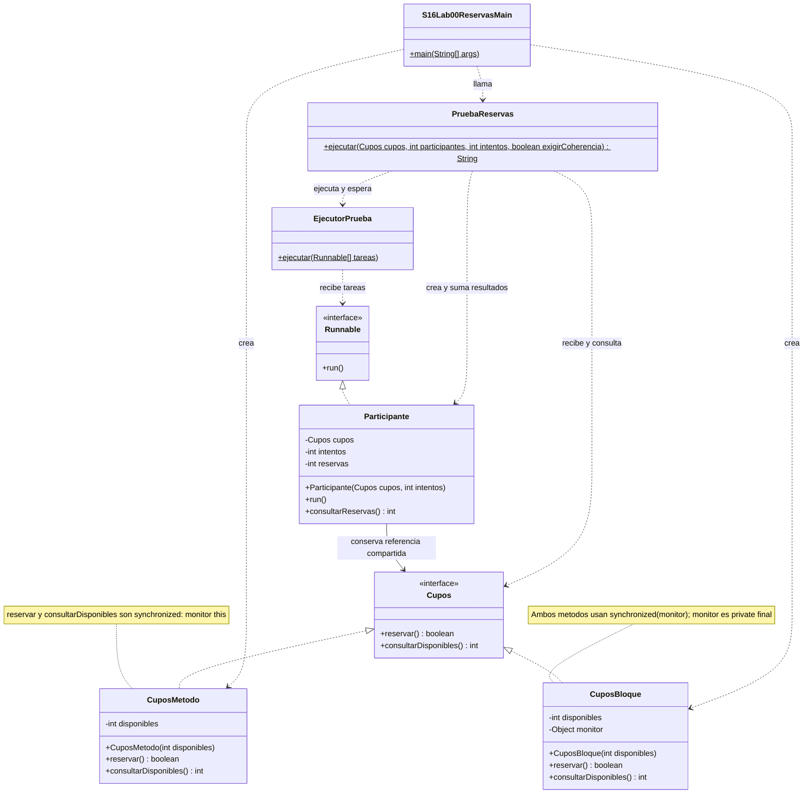

# Lab 00 · Reservas de taller · 20 minutos

Hay **20 cupos** y cuatro participantes intentan reservar diez veces cada uno. Cada intento reserva una sola plaza o se rechaza si no quedan cupos. Las dos versiones ya están codificadas.

## Pasos para completar la actividad

1. Abre [S16Lab00ReservasMain.java](S16Lab00ReservasMain.java). Identifica cuposIniciales = 20 y los argumentos 4 y 10 de cada prueba: cuatro participantes y diez intentos por participante.
2. Antes de ejecutar, calcula: 40 intentos, 20 reservas aceptadas y 20 rechazos. Ejecuta **Run → S16Lab00ReservasMain** y compara ambas versiones con la salida de abajo.
3. Lee [CuposMetodo.java](CuposMetodo.java) y [CuposBloque.java](CuposBloque.java). Localiza la comprobación disponibles <= 0 y el descuento. Marca por qué ambas instrucciones necesitan la misma exclusión.
4. Escribe en tu README: recurso compartido=misma instancia de Cupos; monitor de la primera versión=this; monitor de la segunda=su objeto privado. Cada participante conserva su propio contador, que se suma solo después de que todos terminen.
5. En el Main cambia únicamente `int cuposIniciales = 20;` por `int cuposIniciales = 30;`. No cambies participantes, intentos ni métodos de reserva.
6. Predice y ejecuta: ambas líneas deben mostrar `disponibles=0 reservas=30 rechazos=10 coherente=true`. Guarda la salida y explica por qué las dos versiones deben coincidir aunque cambie quién obtiene cada cupo.
7. En Debug, coloca un breakpoint en reservar de CuposBloque. Localiza el objeto monitor y comprueba qué instancia recibe cada participante. La pausa modifica el reparto; no se exige que cada participante obtenga el mismo número.
8. Responde: si cada participante bloqueara su propio objeto pero compartiera los mismos cupos, ¿estarían protegidas las reservas? Apóyate en el demo de monitores; no introduzcas una barrera dentro del bloque correcto.

## Diagrama UML · Lab 00: reservas de taller

Este diagrama corresponde únicamente al paquete `s16lab00`. El [Demo 00 de inventario](../../demo/s16demo00/README.md) es otro ejercicio: usa `Inventario` y `Vendedor`. Aquí sus responsabilidades se aplican a cupos y participantes; no debes buscar esas clases del demo dentro de este lab.



**Cómo leerlo:** el Main crea una versión de Cupos y la entrega a PruebaReservas. Esta crea los participantes con la misma referencia y delega su ejecución en EjecutorPrueba. Tras esperar a todos, suma sus reservas y valida el cupo final. Se muestran las siete clases/interfaces locales y el contrato Runnable del JDK; los detalles internos de creación de hilos quedan en el apoyo EjecutorPrueba.


## Salida inicial esperada

```text
Metodo: disponibles=0 reservas=20 rechazos=20 coherente=true
Bloque: disponibles=0 reservas=20 rechazos=20 coherente=true
```

**Regla:** cupos iniciales = reservas aceptadas + cupos finales; no negativos ni reservas superiores a los cupos. PruebaReservas comprueba también que se aceptaron todas las reservas posibles. EjecutorPrueba aplica la señal de inicio y espera; esos archivos son apoyo preparado.

[Volver a la sesión](../../README.md)
