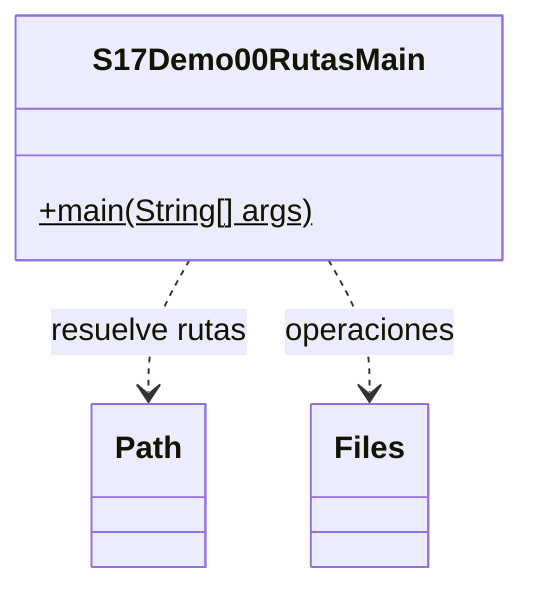

# Demo 00 · Rutas y recursos · 10 minutos

**Problema:** representar una ruta no crea el archivo. Necesitamos preparar el almacenamiento y saber dónde se resuelve una ruta relativa.

1. Lee el Main y ejecuta. Observa el directorio de trabajo, datos/pedidos.txt y su resolución absoluta. Esa ruta explicativa no se escribe; las operaciones reales usan la carpeta Datos que imprime el programa.
2. En una carpeta nueva debe aparecer Archivo creado, Es archivo:true y Bytes:0.
3. Ejecuta otra vez: Archivo existente conservado. El programa no vacía pedidos.txt. Si agregas texto manualmente, una ejecución posterior conserva ese contenido y cambia el tamaño en bytes.
4. Sigue Path.of → resolve → createDirectories → createFile. new File o Path.of por sí solos no crean un archivo.
5. Como prueba de error, en una carpeta de ensayo coloca un directorio llamado pedidos.txt. Se informa una IOException con contexto; no aparece éxito de archivo regular.

En Debug, inspecciona archivo antes de createFile. Las consultas exists/isRegularFile son observaciones; createFile es quien crea y puede lanzar FileAlreadyExistsException. File no tiene close; aquí no conservamos un flujo abierto.

## UML

Clases propias: solo el Main. Los demás tipos son APIs del JDK, sin fuentes locales ni carpeta de apoyo.

[Abrir el Main](S17Demo00RutasMain.java) · [Volver a la sesión](../../README.md)
