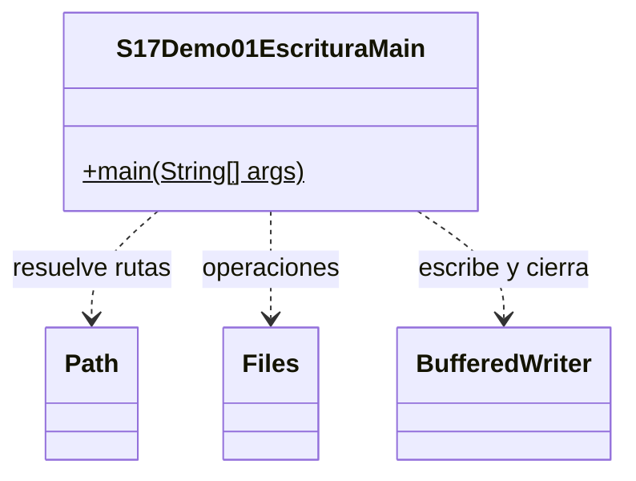

# Demo 01 · Escritura UTF-8 y persistencia · 15 minutos

**Problema:** al reiniciar, los pedidos no deben desaparecer. Elegir truncar o agregar cambia lo que se conserva.

1. Ejecuta sobre una carpeta nueva: Lineas antes:0, Lineas despues:2. Abre historial.txt y comprueba María y Andrés.
2. Cierra el proceso y vuelve a ejecutar el mismo Main con la misma carpeta: antes2, despues4. Las primeras dos líneas permanecen.
3. Sigue el try-with-resources: Files.newBufferedWriter con UTF-8, CREATE y APPEND; write agrega texto y newLine separa registros. Al terminar el bloque se cierra incluso si hay error.
4. Contrasta resumen-reemplazable.txt: ahí elegimos CREATE, WRITE y TRUNCATE_EXISTING. Es otro archivo, nunca el historial.
5. Puedes editar historial.txt fuera del programa y volver a leerlo. No se reconstruye desde una variable al iniciar: la persistencia real está en el archivo.

Si ya existían n líneas, la regla es n →n+2. Cada ejecución agrega dos registros, incluidos duplicados previstos. No se implementa idempotencia ni escrituras concurrentes.

En Debug inspecciona historial y las opciones antes de abrir el escritor. Files.readString/readAllLines gestionan su recurso internamente; no necesitan un close manual. flush no significa borrar datos ni garantiza por sí solo persistencia física ante un fallo eléctrico.

## UML

Clases propias: solo el Main. Los demás tipos son APIs del JDK, sin fuentes locales ni carpeta de apoyo.

[Abrir el Main](S17Demo01EscrituraMain.java) · [Volver a la sesión](../../README.md)
