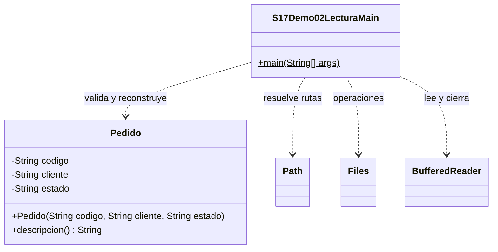

# Demo 02 · Leer y validar pedidos · 15 minutos

**Problema:** leer texto no basta: una línea incompleta no es todavía un Pedido válido.

Los archivos se crean en datos/, dentro de esta carpeta del demo. Ejecuta sin argumentos. En IntelliJ, configura Working directory como la raíz campus-java (Run → Edit Configurations). Path.of recibe las carpetas por separado y adapta los separadores a cada sistema operativo. La consola muestra la ubicación absoluta.

1. Lee Pedido.java y luego el Main. La primera ejecución prepara una muestra solo si pedidos.txt no existe; las siguientes conservan tu edición.
2. Ejecuta: dos registros válidos y dos inválidos. La fila3 está incompleta; la4 tiene estado desconocido. La salida final es Validos:2; invalidos:2.
3. Sigue newBufferedReader → readLine → split(";",-1) → validar → crear Pedido. Se preservan campos vacíos, se ignoran líneas vacías y se informa el número físico de línea.
4. Corrige P-003;María por P-003;María;PENDIENTE en el archivo real y ejecuta: Validos:3; invalidos:1.
5. Para comprobar ausencia sin generar muestra, cambia prepararMuestra a false y la última carpeta de Path.of de datos a datos-sin-muestra (una carpeta nueva). Ejecuta: debe fallar con IOException. Después restaura prepararMuestra = true y datos.

El formato es texto delimitado simple, sin separadores, comillas o saltos dentro de campos; no es un parser CSV general. Los estados admitidos son PENDIENTE y ENTREGADO.

El catch de IllegalArgumentException maneja una fila inválida y permite continuar. IOException de lectura no se oculta en ese catch. El lector se cierra con try-with-resources.

## UML

Clases propias: Main y Pedido. Los demás tipos son APIs del JDK, sin fuentes locales ni carpeta de apoyo.

[Abrir el Main](S17Demo02LecturaMain.java) · [Volver a la sesión](../../README.md)
