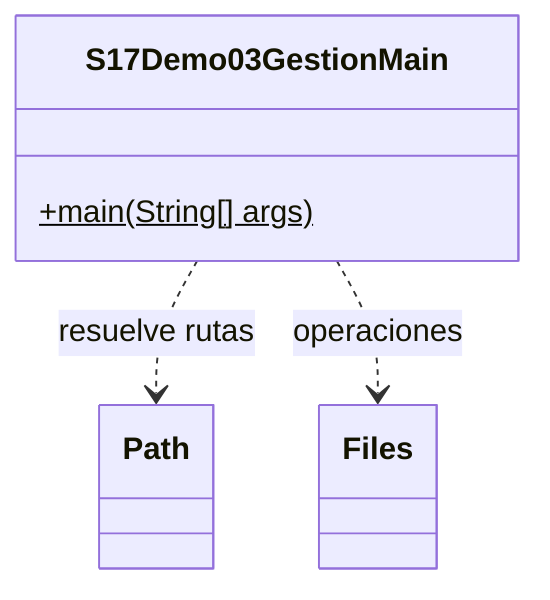

# Demo 03 · Copiar, mover y borrar un borrador · 10 minutos

**Problema:** conservar un pedido, archivar su copia y eliminar únicamente un borrador propio.

1. Ejecuta en una carpeta nueva. Se prepara pedido.txt, se copia a respaldo.txt y solo esa copia se mueve a historico/pedido.txt.
2. Comprueba: origen presente=true, respaldo presente=false, historico presente=true. Los contenidos de origen e histórico coinciden.
3. Ejecuta otra vez: el histórico existente no se reemplaza; la nueva copia queda en respaldo.txt. Ambos contenidos se conservan.
4. Ejecuta una tercera vez: como respaldo.txt ya existe, no se reemplaza ni se mueve ese respaldo previo.
5. En cada ejecución se crea un borrador temporal y se elimina solo la ruta devuelta por createTempFile. Se informa Borrador propio eliminado:true. No se borran recursivamente carpetas ni documentos de otros ejercicios.

En Debug inspecciona origen, respaldo e historico antes de copy/move. No se utiliza REPLACE_EXISTING. Si copiar falla por destino existente, no se procede a mover como si hubiera funcionado. Otros fallos de IO se propagan; no se promete atomicidad de todos los movimientos.

## UML

Clases propias: solo el Main. Los demás tipos son APIs del JDK, sin fuentes locales ni carpeta de apoyo.

[Abrir el Main](S17Demo03GestionMain.java) · [Volver a la sesión](../../README.md)
