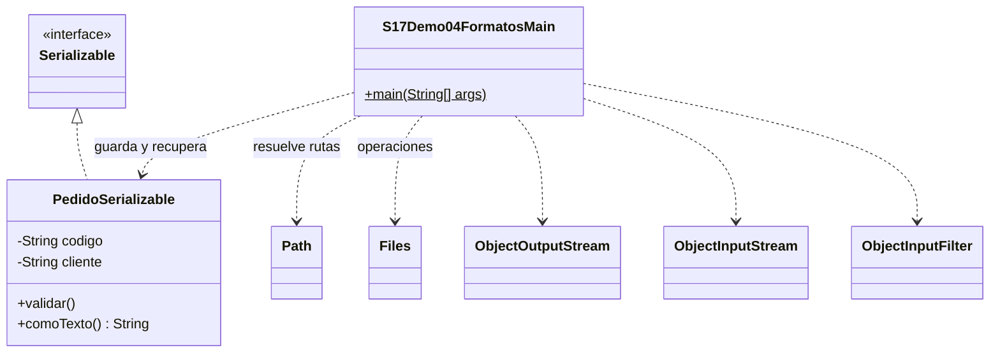

# Demo 04 · Texto y serialización nativa · 8 minutos

**Problema:** conservar el mismo estado no exige un único formato. Compara lectura humana con acoplamiento a clases Java.

1. Lee PedidoSerializable.java: Serializable es una interfaz marcadora; serialVersionUID participa en compatibilidad, no migra esquemas.
2. Ejecuta: Texto:P-001;María, Binario recuperado:P-001;María y Mismo contenido:true. Los nombres finales varían porque se crean archivos propios únicos.
3. Abre el .txt para reconocer sus campos; el .ser contiene serialización binaria, no texto aunque lo renombraras.
4. Sigue ObjectOutputStream y ObjectInputStream con try-with-resources. El demo solo lee el archivo que acaba de crear.
5. Observa el filtro preparado: admite el tipo propio y limita profundidad, referencias, bytes y arreglos. Después se valida el tipo y los campos recuperados: deserializar no ejecuta el constructor de la clase serializable.

No cambies el origen por un binario externo desconocido. Un filtro reduce riesgo, no convierte archivos arbitrarios en seguros. El filtro es apoyo configurado, no contenido de un laboratorio adicional.

El texto delimitado simple es legible e interoperable bajo sus restricciones; la serialización nativa depende más de clases Java. No se exige aprender infraestructura de filtros ni crear un formato JSON.

## UML

Clases propias: Main y PedidoSerializable. Los demás tipos son APIs del JDK, sin fuentes locales ni carpeta de apoyo.

[Abrir el Main](S17Demo04FormatosMain.java) · [Volver a la sesión](../../README.md)
