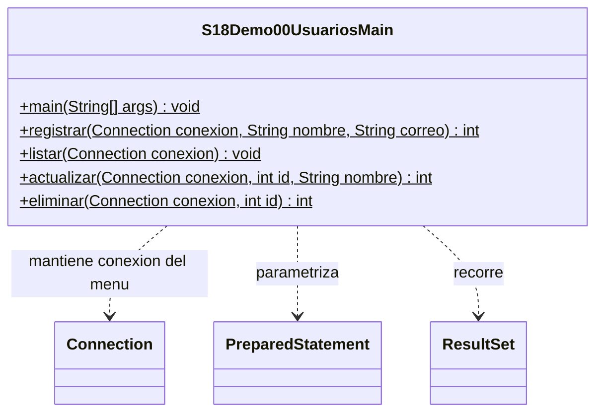

# Demo 00 · JDBC básico: CRUD de usuarios · 30 minutos

**Un mismo programa, dos formas de incorporar Connector/J.** Ambas versiones conectan a MySQL y permiten registrar, listar, actualizar y eliminar usuarios. El código Java es idéntico: la diferencia es cómo el driver queda disponible en el classpath, no el mecanismo de conexión JDBC.

| Versión | Carpeta | Configuración |
| --- | --- | --- |
| Demo00-1 · JAR manual | [demo00-1](demo00-1/src/s18demo00/S18Demo00UsuariosMain.java) | JAR agregado al módulo de IntelliJ |
| Demo00-2 · Maven | [demo00-2](demo00-2/pom.xml) | Dependencia declarada en el POM |

## Preparación de MySQL

Primero realiza la [preparación de base, usuario y variables](../../README.md#preparación-anterior-a-clase). MySQL Server debe estar funcionando; ni el JAR ni Maven instalan el servidor.

Ejecuta este bloque con la cuenta administrativa en tu cliente MySQL:

```sql
USE campus_java_s18;

CREATE TABLE IF NOT EXISTS usuarios (
    id INT AUTO_INCREMENT PRIMARY KEY,
    nombre VARCHAR(100) NOT NULL,
    correo VARCHAR(150) NOT NULL UNIQUE
);

-- Semillas opcionales. No reemplazan los registros creados desde Java.
INSERT INTO usuarios (nombre, correo)
SELECT 'Ana Torres', 'ana.torres@example.com'
WHERE NOT EXISTS (SELECT 1 FROM usuarios WHERE correo = 'ana.torres@example.com');
INSERT INTO usuarios (nombre, correo)
SELECT 'Luis Rojas', 'luis.rojas@example.com'
WHERE NOT EXISTS (SELECT 1 FROM usuarios WHERE correo = 'luis.rojas@example.com');

SELECT id, nombre, correo FROM usuarios ORDER BY id;
```

El archivo [preparar.sql](preparar.sql) contiene el mismo bloque. Las semillas son opcionales; sin ellas el primer listado informa `Sin usuarios.`. IF NOT EXISTS no actualiza una tabla antigua: consulta SHOW CREATE TABLE usuarios si hay diferencias y pide orientación. No borres datos. Ambas versiones usan la misma tabla; no vuelvas a insertar los registros de práctica al cambiar de versión.

## Demo00-1 · Incorporar el JAR manualmente

1. Descarga la distribución ZIP independiente de plataforma de **Connector/J 8.4.0** desde la [página oficial](https://dev.mysql.com/downloads/connector/j/8.4.html); si no aparece seleccionada, usa el archivo de versiones anteriores. Usamos la misma versión en Maven.
2. Extrae `mysql-connector-j-8.4.0.jar` y consérvalo en una carpeta local estable. No publiques el binario.
3. Abre **demo00-1** como proyecto Java en una ventana independiente de IntelliJ. Selecciona JDK 17 o 21.
4. Marca su carpeta `src` como **Sources Root** si hace falta.
5. En **File → Project Structure → Modules → Dependencies → + → JARs or directories**, agrega el JAR con alcance Compile y aplica.
6. Ejecuta `s18demo00.S18Demo00UsuariosMain`. En **Run → Edit Configurations → Environment variables**, configura DB_URL, DB_USER y DB_PASSWORD según el README de sesión. No necesita Program arguments.
7. Comprueba que aparece `Conexion comprobada` y el menú. Compilar sin el JAR puede funcionar porque java.sql está en el JDK; el driver es necesario al conectar.
8. Si eliminas esa dependencia, la conexión dejará de encontrar un driver adecuado. Restáurala antes de seguir. Una actualización de versión exige sustituir el JAR manualmente.

## Demo00-2 · Incorporar el driver con Maven

1. Abre su [pom.xml](demo00-2/pom.xml) como proyecto Maven en **otra ventana** de IntelliJ. Alternativamente, abre el [POM de sesión](../../pom.xml) para disponer de demo00-2 y demo01.
2. Selecciona JDK 17/21. Localiza `com.mysql:mysql-connector-j` y versión `8.4.0` en el POM.
3. Pulsa **Reload All Maven Projects** y espera. La primera resolución necesita Internet para descargar dependencias y plugins.
4. Comprueba Connector/J en External Libraries. **No agregues el JAR manual**. Maven configura `src/main/java` como fuente.
5. Ejecuta `s18demo00.S18Demo00UsuariosMain` del módulo Maven y configura las mismas variables de entorno en su Run.
6. Prueba el mismo menú. Al cambiar de ventana pueden seguir apareciendo los datos creados por la otra versión: ambas usan MySQL, no una lista en memoria.
7. Para actualizar la biblioteca, modifica su versión en el POM, verifica compatibilidad y recarga Maven. `mvn compile` compila, no ejecuta el menú; aquí usamos Run de IntelliJ.

No abras ambas copias como fuentes de un único módulo: tienen el mismo paquete y nombre de clase por ser el mismo ejemplo. La configuración del JAR manual debe estar aislada de Maven para que no esconda errores de classpath.

## Recorrido guiado del CRUD

1. Lee el inicio de main: obtiene configuración externa, abre Connection y comprueba isValid(5).
2. Elige **2 Listar**. Observa las semillas o el mensaje de tabla vacía. En `listar`, sigue executeQuery → ResultSet → next → lectura de columnas.
3. Elige **1 Registrar** con `María Práctica` / `maria.practica@example.com`. Debe aparecer `Filas insertadas: 1`. Lee el INSERT con dos `?` y sus setString numerados desde 1.
4. Lista y anota su id real. Sal con **0**, ejecuta otra vez y verifica persistencia. Al comparar versiones, puedes consultar este mismo registro sin insertarlo de nuevo.
5. Elige **3 Actualizar nombre**, introduce ese id y `María Actualizada`. Espera `Filas afectadas: 1` y lista para comprobarlo.
6. Prueba un id positivo que verificaste que no existe: `Sin coincidencias para ese id.` es un resultado normal, no una SQLException.
7. Elige **4 Eliminar**, introduce el id de María y confirma con `SI`. Lista y comprueba su ausencia. Otra respuesta cancela.
8. Registra `D'Angelo` / `dangelo@example.com`; el apóstrofo se conserva porque se pasa como dato. Repite el correo para observar rechazo UNIQUE. Para repetir toda la práctica usa otro correo ficticio, sin borrados globales.

```sql
SELECT id, nombre, correo FROM usuarios ORDER BY id;
SELECT id, nombre, correo FROM usuarios WHERE correo = 'maria.practica@example.com';
```

En Debug, detente antes de executeUpdate para inspeccionar parámetros y después el entero devuelto. Antes de eliminar, verifica siempre el id del registro de práctica.

## Ideas que deben quedar claras

- executeUpdate devuelve filas afectadas para INSERT/UPDATE/DELETE; executeQuery devuelve ResultSet para SELECT. Confirma siempre el estado real con una consulta.
- La Connection permanece durante el menú; cada método cierra sus sentencias/resultados. Al salir se cierran conexión y Scanner con try-with-resources.
- SQLException se informa con SQLState/código; no imprime credenciales ni inventa éxito. El código 1062 de MySQL indica duplicado; 1049 base desconocida. Un fallo de acceso suele tener SQLState 28000. Falta de driver suele dar 08001; servidor/puerto no disponible suele dar 08S01. Revisa el contexto, no solo un código.
- La validación de correo es introductoria: contenido, longitud y @; no es una verificación completa de direcciones.
- Se usa auto-commit para sentencias individuales. Todavía no se introduce MVC: una clase con métodos permite ver JDBC directamente.

## UML · Demo00-1

Única clase propia: el Main. Los demás tipos son APIs JDBC.



## UML · Demo00-2

El mismo diseño; Maven no cambia las clases ni la conexión.


[Continuar con demo01 · MVC](../s18demo01/README.md) · [Volver a la sesión](../../README.md)
