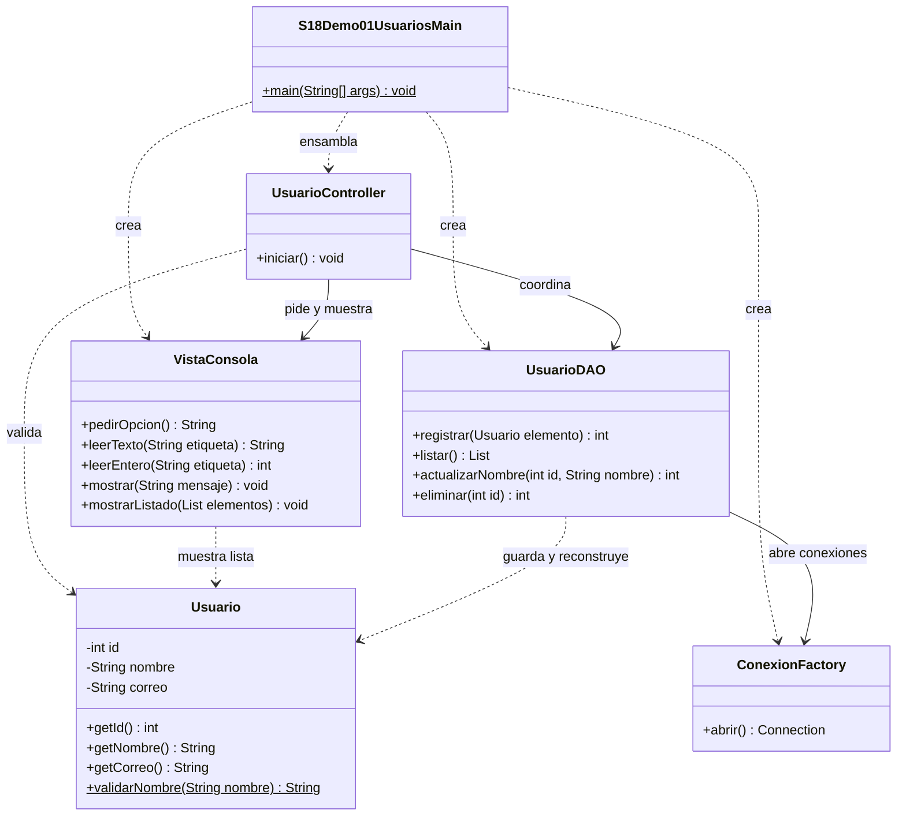

# Demo 01 · Usuarios con MVC + DAO · 25 minutos

**Problema:** cambiar mensajes y consultas obliga a recorrer una clase que mezcla responsabilidades. Conservaremos la misma tabla y el mismo CRUD del demo00 y distribuiremos el trabajo.

## Preparar y ejecutar

1. Completa la [preparación de MySQL e IntelliJ](../../README.md#preparación-anterior-a-clase).
2. Abre el POM de la sesión, sincroniza Maven y selecciona este módulo en la configuración Run del Main.
3. En el cliente MySQL, ejecuta el siguiente bloque. Las semillas son opcionales: puedes omitir los INSERT para comenzar con la tabla vacía.

```sql
USE campus_java_s18;

CREATE TABLE IF NOT EXISTS usuarios (
    id INT AUTO_INCREMENT PRIMARY KEY,
    nombre VARCHAR(100) NOT NULL,
    correo VARCHAR(150) NOT NULL UNIQUE
);

-- Semillas opcionales. No reemplazan los registros creados desde Java.
INSERT INTO usuarios (nombre, correo)
SELECT 'Ana Torres', 'ana.torres@example.com'
WHERE NOT EXISTS (SELECT 1 FROM usuarios WHERE correo = 'ana.torres@example.com');
INSERT INTO usuarios (nombre, correo)
SELECT 'Luis Rojas', 'luis.rojas@example.com'
WHERE NOT EXISTS (SELECT 1 FROM usuarios WHERE correo = 'luis.rojas@example.com');

SELECT id, nombre, correo FROM usuarios ORDER BY id;
```

El mismo contenido está en [preparar.sql](preparar.sql). `IF NOT EXISTS` no modifica una tabla antigua: si las columnas no coinciden, comprueba `SHOW CREATE TABLE usuarios;` y consulta al docente. No borres la tabla para reiniciar. La carga opcional evita repetir estas semillas en una preparación local secuencial; no es una solución para inserciones concurrentes. Los id los asigna MySQL y pueden tener saltos.

4. **Si hiciste demo00, conserva sus datos.** No necesitas repetir las semillas; ambos diseños usan la misma tabla.
5. Ejecuta [S18Demo01UsuariosMain](src/main/java/s18demo01/S18Demo01UsuariosMain.java) con las mismas variables de entorno. Aquí cada operación abre/cierra su conexión; el menú puede abrirse antes de conectar.

## Orden de lectura y comprobación

1. **Main:** crea vista, DAO y controlador. Solo ensambla; no contiene SQL.
2. **Usuario:** identifica id, nombre y correo. Constructor y `validarNombre` protegen datos básicos; no importan JDBC ni Scanner.
3. **VistaConsola:** muestra el menú y lee texto. Cambia un mensaje: no debes tocar el DAO.
4. **UsuarioController:** sigue la opción 1; obtiene datos de la vista, crea Usuario y pide al DAO registrarlo.
5. **UsuarioDAO:** sigue `registrar`: abre conexión, prepara INSERT, asigna parámetros y devuelve filas afectadas. No imprime resultados.
6. **ConexionFactory:** obtiene credenciales externas y entrega una conexión nueva. No guarda una conexión global ni devuelve null cuando falla.
7. Ejecuta **1 Registrar** con `Elena Demo MVC` / `elena.mvc@example.com`; comprueba `Filas insertadas: 1`. Con **2 Listar**, anota su id real.
8. Elige **3**, escribe ese id y `Elena Actualizada`; lista para verificarlo. Elige **4** y confirma `SI`; verifica que desapareció.
9. Repite una inserción con un correo existente, prueba id inexistente y nombre vacío. El controlador pide a la vista mostrar el error o ausencia; no inventa un resultado exitoso.

```sql
SELECT id, nombre, correo FROM usuarios ORDER BY id;
SELECT id, nombre, correo FROM usuarios WHERE correo = 'elena.mvc@example.com';
```

En Debug, sigue registrar desde controlador hasta DAO; usa Step Into para ver el cambio de responsabilidad. El ResultSet se transforma en `List<Usuario>` dentro del DAO y se cierra antes de entregar la lista.

| Cambio | Componente principal |
| --- | --- |
| Texto mostrado | VistaConsola |
| Regla de nombre obligatorio | Usuario |
| Acción del menú | UsuarioController |
| Consulta SQL | UsuarioDAO |
| Apertura de conexión | ConexionFactory |

El DAO concreto complementa MVC; no es una cuarta parte del nombre MVC. Para este caso no necesitamos Service, interfaces adicionales ni frameworks. Comparado con demo00, mantenemos comportamiento y tabla; cambiamos la distribución del código.

## UML

Las seis clases propias están representadas. Las relaciones muestran colaboración, sin atribuir propiedad exclusiva de ciclo de vida.



[Volver a la sesión](../../README.md)
