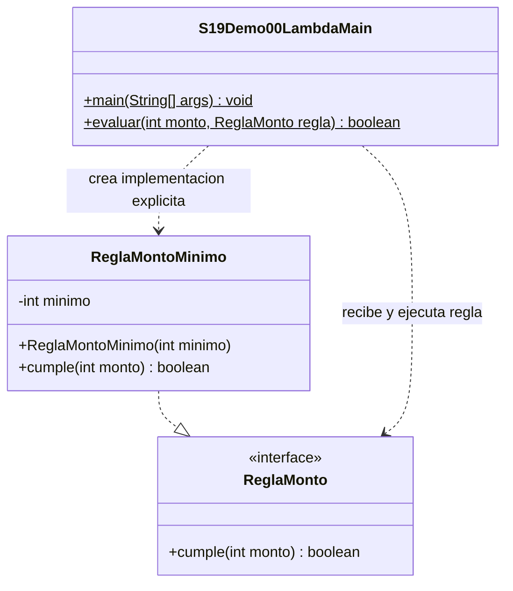

# Demo00 · De interfaz a lambda · 8 minutos

**Problema:** evaluar compras con reglas distintas sin dejar una condición fija dentro del método que las procesa.

## Ejecutar en IntelliJ

Usa JDK 17 o 21. En el proyecto campus-java, esta sesión necesita únicamente `demo/` marcada como **Sources Root** (clic derecho → Mark Directory as → Sources Root). No marques todo `src/`: sus carpetas organizativas tienen guiones.

Abre [S19Demo00LambdaMain.java](S19Demo00LambdaMain.java) y pulsa el triángulo junto a main → Run. No necesitas Maven, dependencias, argumentos, MySQL ni entrada por teclado.

## Orden de explicación

1. Abre [ReglaMonto](ReglaMonto.java): su único contrato es `boolean cumple(int monto)`. @FunctionalInterface ayuda a detectar un segundo método abstracto accidental; puede haber métodos default/static.
2. Abre [ReglaMontoMinimo](ReglaMontoMinimo.java): implementa explícitamente el contrato y guarda el mínimo recibido.
3. En el Main compara `new ReglaMontoMinimo(minimo)` con `monto -> monto >= minimo`. Ambas alternativas reciben un int y devuelven boolean.
4. Sigue `evaluar`: recibe el monto y la regla; llamar `regla.cumple(monto)` ejecuta el comportamiento. Definir la variable lambda no lo ejecuta.
5. Observa la variante positiva con llaves y return. Con una expresión de resultado se puede omitir ese bloque.
6. Predice qué ocurriría al cambiar el mínimo a 200000 y ejecuta. Después restaura 100000.
7. Descomenta solo la reasignación indicada: el compilador rechaza capturar `minimo` porque deja de ser effectively final. Coméntala otra vez para ejecutar.

**Tipo objetivo:** ReglaMonto indica los parámetros y el retorno que debe cumplir la lambda; no es una función sin contrato. La implementación con clase sirve para comparar comportamientos, no significa que el compilador genere literalmente esa clase fuente.

## Salida esperada

```text
150000 | clase=true | lambda=true
99999 | clase=false | lambda=false
100000 | clase=true | lambda=true
Positivo 25: true
Positivo -3: false
```

En Debug, detente en evaluar y entra en cumple. Explica por qué el límite inclusivo acepta100000. Effectively final restringe reasignar la variable local capturada, no vuelve inmutables todos los objetos.

## UML

Las tres declaraciones son fuentes reales; la lambda no se dibuja como otra clase inexistente.



[Volver a la sesión](../../README.md)
