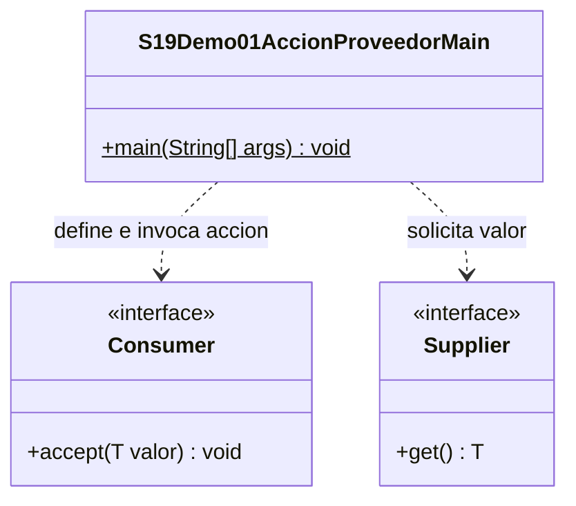

# Demo01 · Consumer y Supplier · 10 minutos

**Problema:** obtener un aviso no es lo mismo que mostrarlo. Una operación suministra el texto; otra realiza la acción de imprimir.

## Ejecutar en IntelliJ

Usa JDK 17 o 21. En el proyecto campus-java, esta sesión necesita únicamente `demo/` marcada como **Sources Root** (clic derecho → Mark Directory as → Sources Root). No marques todo `src/`: sus carpetas organizativas tienen guiones.

Abre [S19Demo01AccionProveedorMain.java](S19Demo01AccionProveedorMain.java) y pulsa el triángulo junto a main → Run. No necesitas Maven, dependencias, argumentos, MySQL ni entrada por teclado.

| Contrato | Recibe | Devuelve | Invocación |
| --- | --- | --- | --- |
| Consumer<String> | Un String | void | accept(texto) |
| Supplier<String> | Ningún argumento | String | get() |

## Orden de explicación

1. Lee las dos declaraciones del Main. No confundir `() ->` con un parámetro vacío de tipo String: aquí no se recibe nada.
2. Ejecuta hasta la primera línea numerada: definir las lambdas todavía no pidió ni mostró su mensaje.
3. En `mensajeInicial.get()`, observa el String devuelto. Se puede guardar en la variable mensaje.
4. En `mostrarAviso.accept(mensaje)`, observa el efecto en consola. accept no devuelve el texto; no puedes asignarlo a un String.
5. Lee `mostrarAviso.accept(mensajeInicial.get())`: primero se obtiene el valor y luego se entrega a la acción. Otra llamada a get puede devolver el mismo texto; Supplier no promete unicidad ni caché.
6. Compara las dos últimas acciones: `texto -> System.out.println(texto)` y `System.out::println` hacen lo mismo. El consumidor con prefijo AVISO es otro comportamiento.
7. Cambia solo el texto del Supplier a Pedido pendiente y predice cuáles líneas cambian. Restaura el original.

## Salida esperada

```text
1. Comportamientos definidos; todavia no se solicito el mensaje.
2. Valor suministrado: Pedido recibido
AVISO: Pedido recibido
3. Solicitar y mostrar otra vez:
AVISO: Pedido recibido
4. Delegacion equivalente:
Pedido registrado
Pedido registrado
```

En Debug, inspecciona mensaje después de get. Pregunta de contraste: ¿por qué Consumer no serviría para obtener un texto que deba reutilizarse en otro cálculo?

## UML

Única clase propia: Main. Consumer y Supplier son interfaces del JDK; la lambda define el comportamiento compatible con ellas.



[Volver a la sesión](../../README.md)
