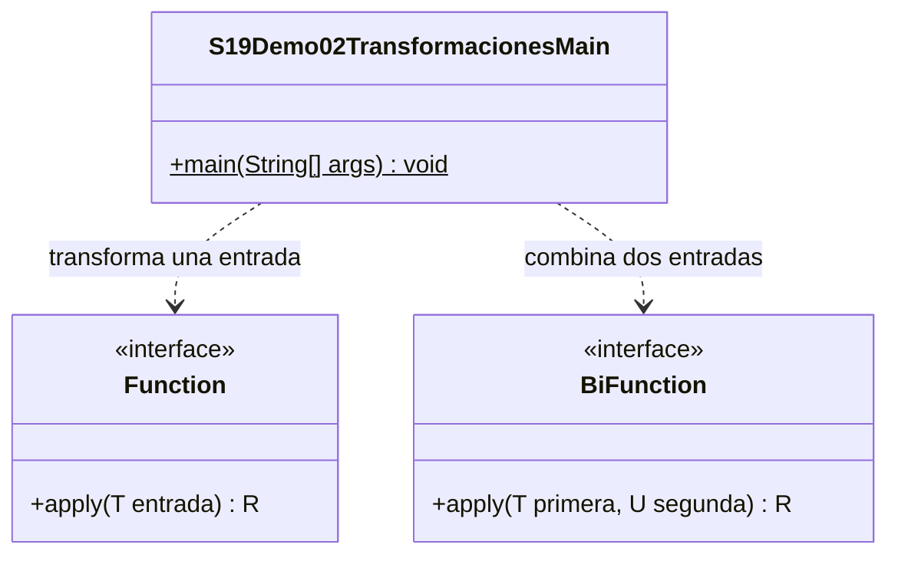

# Demo02 · Function y BiFunction · 10 minutos

**Problema:** hay resultados que se calculan y después se reutilizan. Algunos dependen de una entrada; otros, de dos.

## Ejecutar en IntelliJ

Usa JDK 17 o 21. En el proyecto campus-java, esta sesión necesita únicamente `demo/` marcada como **Sources Root** (clic derecho → Mark Directory as → Sources Root). No marques todo `src/`: sus carpetas organizativas tienen guiones.

Abre [S19Demo02TransformacionesMain.java](S19Demo02TransformacionesMain.java) y pulsa el triángulo junto a main → Run. No necesitas Maven, dependencias, argumentos, MySQL ni entrada por teclado.

| Contrato | Recibe | Devuelve | Invocación |
| --- | --- | --- | --- |
| Function<T,R> | Un dato T | Un resultado R | apply(dato) |
| BiFunction<T,U,R> | Un T y un U | Un resultado R | apply(dato1, dato2) |

## Orden de explicación

1. Sigue contarLetras: recibe String y devuelve Integer. Predice el resultado de Maria antes de ejecutar.
2. Sigue aplicarDescuento: recibe precio y captura el descuento local fijo10000. Para90000 el resultado es **80000**, no180000.
3. Sigue calcularSubtotal: recibe precio unitario y cantidad, no una colección; devuelve su producto. Los tres parámetros genéricos describen entrada1, entrada2 y salida.
4. Guarda mentalmente el cálculo antes de mirar println: apply devuelve un valor; println lo muestra después. Consumer, en cambio, realiza una acción con retorno void.
5. Compara contarLetras con String::length: ambas usan length sobre el String recibido. Las firmas deben ser compatibles.
6. Cambia cantidad2 por3: espera90000. Restaura2 y ejecuta de nuevo.

## Salida esperada

```text
Letras de Maria: 5
90000 menos 10000: 80000
30000 por 2: 60000
30000 por 0: 0
Lambda con Java: 4
Referencia con Java: 4
```

Los importes usan pesos enteros y datos pequeños. La cantidad0 ilustra la función matemática; no define una regla universal para pedidos reales. Evitamos lógica de negocio adicional para concentrarnos en la firma.

En Debug, inspecciona precioUnitario y cantidad al entrar en apply. ¿Qué cambia si el resultado no es Integer sino String? El tipo de retorno del contrato debe reflejarlo.

## UML

Solo Main es una clase del proyecto. Function y BiFunction son contratos del JDK; no son clases auxiliares locales.



[Volver a la sesión](../../README.md)
