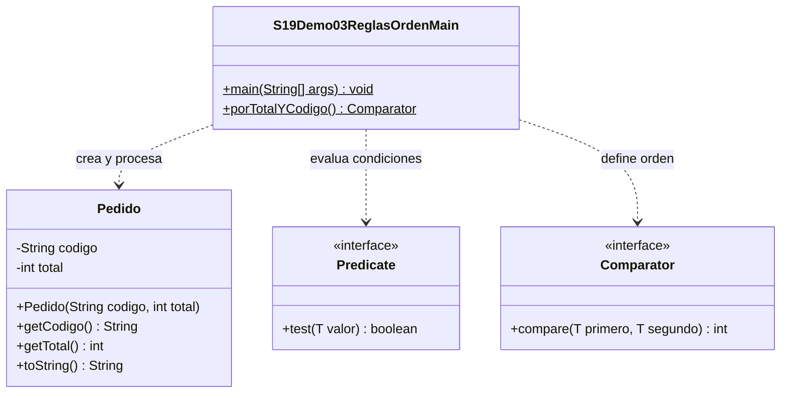

# Demo03 · Predicate y Comparator · 12 minutos

**Problema:** seleccionar pedidos elegibles y ordenar pedidos son necesidades distintas, aunque ambas se describan con lambdas.

## Ejecutar en IntelliJ

Usa JDK 17 o 21. En el proyecto campus-java, esta sesión necesita únicamente `demo/` marcada como **Sources Root** (clic derecho → Mark Directory as → Sources Root). No marques todo `src/`: sus carpetas organizativas tienen guiones.

Abre [S19Demo03ReglasOrdenMain.java](S19Demo03ReglasOrdenMain.java) y pulsa el triángulo junto a main → Run. No necesitas Maven, dependencias, argumentos, MySQL ni entrada por teclado.

| Contrato | Recibe | Devuelve | Método |
| --- | --- | --- | --- |
| Predicate<Pedido> | Un Pedido | boolean | test(pedido) |
| Comparator<Pedido> | Dos Pedido | int de orden | compare(primero, segundo) |

Comparator pertenece a java.util; Predicate a java.util.function. **List.sort espera Comparator**, no BiFunction.

## Orden de explicación

1. Lee [Pedido](Pedido.java): código y total no negativo. El Main crea A:100000,B:80000,C:100000.
2. Predice cuáles cumplen el mínimo100000. `test` evalúa la regla, pero no quita elementos de una lista por sí solo. El ciclo agrega los elegibles a una lista nueva.
3. Lee las reglas and,or,negate: and exige ambas; or acepta al menos una; negate invierte el resultado. PROMO con80000 obtiene beneficio por su código, aunque no llegue al mínimo.
4. Abre porTotalYCodigo: compara total con Integer.compare. Si hay empate, compara código. No restes enteros para implementar la comparación: puede desbordar.
5. Predice el orden B,A,C y sigue sort en una copia ArrayList. La lista original permanece igual.
6. Interpreta compare: negativo=primero antes; cero=empatados en el criterio; positivo=primero después. No necesita devolver exactamente-1 o1 y empate no significa identidad de objetos.
7. Como variante, descomenta las dos líneas de comparingInt/thenComparing. Deben producir el mismo orden; vuelve a comentarlas.
8. Modifica solo el total de B a120000: elegiblesA,B,C; ordenA,C,B. Restaura80000.

## Salida esperada

```text
Original: [A:100000, B:80000, C:100000]
Elegibles: [A:100000, C:100000]
En rango A: true
Beneficio PROMO de 80000: true
No cumple minimo B: true
Orden total/codigo: [B:80000, A:100000, C:100000]
Original conservada: [A:100000, B:80000, C:100000]
Comparar B con A: -1
Comparar A consigo: 0
Comparar C con A: 2
```

El2 final viene de comparar C con A como texto; importa que sea positivo. Una BiFunction con dos entradas no se puede entregar directamente a sort: el contexto exige el contrato de Comparator. Primero pregunta qué necesita el método receptor, no solo cuántos parámetros tiene la lambda.

En Debug, detente en el if porTotal y observa cuándo se necesita el desempate por código.

## UML

Las clases locales son Pedido y Main. Predicate y Comparator son interfaces del JDK. Las listas guardan referencias a pedidos; no se afirma propiedad exclusiva de su ciclo de vida.



[Volver a la sesión](../../README.md)
