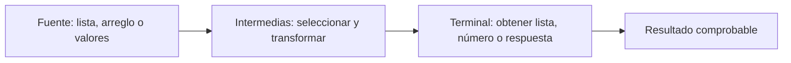

# Sesión 20 · Stream API · Del dato al resultado

**Objetivo:** convertir una pregunta sobre datos en un procesamiento claro y comprobar el resultado. Recuperamos las lambdas de la sesión19: Predicate selecciona, Function transforma y Comparator define un orden.

| Actividad | Tiempo |
| --- | ---: |
| Introducción: fuente, intermedias y terminal | 10 min |
| [Demo00 · primer Stream](demo/s20demo00/README.md) | 8 min |
| [Demo01 · tres fuentes](demo/s20demo01/README.md) | 12 min |
| [Demo02 · órdenes e ítems](demo/s20demo02/README.md) | 20 min |
| [Seis laboratorios, diez minutos cada uno](labs/README.md) | 60 min |
| Cierre de curso y sustentaciones de muestra | 10 min |
| **Total** | **120 min** |

El entorno debe estar preparado antes de clase. Los labs no contienen código inicial; el estudiante elige y explica las operaciones que usará. Las sustentaciones restantes se organizan en los espacios que indique el docente.

## Antes de comenzar

- JDK17/21 e IntelliJ. Solo la carpeta demo de esta sesión es raíz de fuentes; cada demo tiene su paquete y un Main independiente.
- Todo usa datos pequeños en memoria. No necesitas Maven ni bibliotecas.
- Una colección almacena datos; un Stream representa procesamiento. No prometemos que todo Stream sea más rápido que un ciclo.
- Las intermedias describen operaciones; la terminal solicita el resultado. Un Stream no se reutiliza después de consumirlo: otra pregunta comienza con otro stream desde la fuente.
- No modifiques la fuente ni acumules en variables externas dentro de map/filter. Los ejemplos preservan sus datos originales.
- toList devuelve una lista no modificable; para una copia modificable usa ArrayList. No es lo mismo que "todos los objetos de la lista son inmutables".

## Qué debes reconocer

Primero predice la salida de cada demo. Después ejecuta y utiliza Debug si el resultado difiere. En los labs justifica el procesamiento con palabras antes de escribirlo.

No introducimos parallelStream, Gatherers ni sistemas externos. Como cierre, explica cuándo un ciclo sería más claro y cómo decidirías entre lista, conteo, total o respuesta sí/no.

Fuentes: [Stream del JDK21](https://docs.oracle.com/en/java/javase/21/docs/api/java.base/java/util/stream/Stream.html), [IntStream](https://docs.oracle.com/en/java/javase/21/docs/api/java.base/java/util/stream/IntStream.html).
