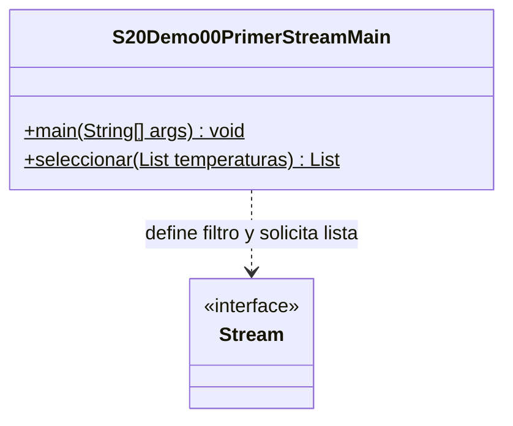

# Demo00 · Un primer Stream · 8 minutos

**Problema:** de las temperaturas [24,30,35,28], necesitamos las que alcanzan30grados o más, conservando el orden.

## Ejecutar

Usa JDK 17/21 en IntelliJ y marca únicamente `demo/` de esta sesión como **Sources Root**, no todo el src organizativo del curso. Abre [S20Demo00PrimerStreamMain.java](S20Demo00PrimerStreamMain.java) → triángulo junto a main → Run. Sin Maven, teclado, archivos, MySQL ni dependencias externas.

## Orden de explicación

1. Lee el ciclo conocido y predice [30,35]. Guarda las coincidencias en una lista nueva.
2. Sigue `temperaturas.stream().filter(...)`: la fuente es la lista y filter recibe la condición de paso.
3. Observa la variable seleccion: describe un procesamiento, no contiene todavía una lista resultado.
4. Al ejecutar `seleccion.toList()`, se obtiene la lista. En Debug, un breakpoint dentro de la condición permite observar cuándo se evalúa: al solicitar el resultado terminal.
5. Compara con el ciclo y comprueba que la lista original no cambió.
6. Revisa sin coincidencias y fuente vacía: producen [], no un error.
7. Cambia el límite de las dos condiciones de30 a35; espera [35]. Restáuralo después.

## Salida esperada

```text
Con ciclo: [30, 35]
Pipeline definido; falta obtener el resultado.
Con stream: [30, 35]
Original: [24, 30, 35, 28]
Sin coincidencias: []
Fuente vacia: []
```

**Fuente → condición → terminal → lista.** filter selecciona, no cambia una temperatura. toList produce lista no modificable; no descomentes un add para el ejemplo normal. La variable seleccion ya se consumió: no vuelvas a usarla; crea otro stream desde temperaturas si necesitas otra consulta.

No utilizamos peek para lógica ni para afirmar que cada etapa debe ejecutarse siempre: la implementación puede optimizar pasos que no cambian el resultado. Aquí la condición sí determina qué elementos forman la lista.

## UML

La única clase propia es Main; Stream es una interfaz del JDK. La lambda no se representa como una clase fuente inexistente.



[Volver a la sesión](../../README.md)
