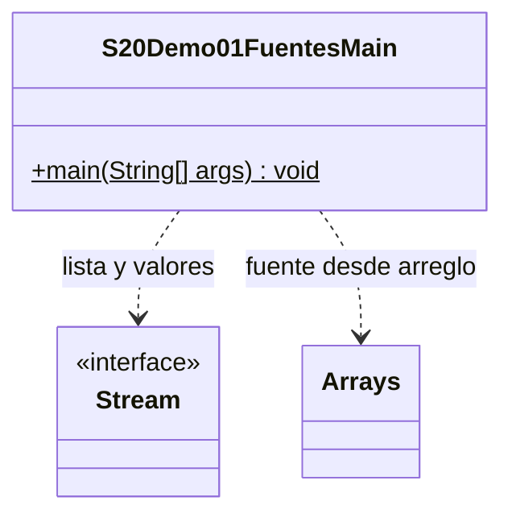

# Demo01 · Tres fuentes, nuevas preguntas · 12 minutos

**Problema:** tenemos los mismos nombres en una lista, en un arreglo y como valores directos. Queremos los que comienzan con L.

## Ejecutar

Usa JDK 17/21 en IntelliJ y marca únicamente `demo/` de esta sesión como **Sources Root**, no todo el src organizativo del curso. Abre [S20Demo01FuentesMain.java](S20Demo01FuentesMain.java) → triángulo junto a main → Run. Sin Maven, teclado, archivos, MySQL ni dependencias externas.

| Fuente | Creación | Tipo en este ejemplo |
| --- | --- | --- |
| List<String> | lista.stream() | Stream<String> |
| String[] | Arrays.stream(arreglo) | Stream<String> |
| Valores String | Stream.of(...) | Stream<String> |

## Orden de explicación

1. Identifica los datos Ana,Luis,Luz,Pablo en las tres fuentes.
2. Predice el mismo resultado para los tres bloques: [Luis,Luz]. Sigue fuente → filter → toList.
3. Revisa los imports de Arrays y Stream. Cambia la fuente, pero no la intención de la consulta.
4. Ahora necesitamos una cantidad: el bloque de count crea un stream nuevo y devuelve long, no List.
5. Otra pregunta: ¿existe algún nombre con Z? anyMatch devuelve boolean y puede detenerse cuando conoce la respuesta. Aquí devuelve false.
6. Observa la lista y el arreglo originales: conservan todos sus nombres.
7. Cambia el prefijo Z por A solo en la pregunta de existencia; espera true. Restaura Z.
8. Lee las tres líneas comentadas de consumido: count ya lo utiliza. No ejecutes después toList sobre la misma instancia; inicia otra consulta desde lista.

## Salida esperada

```text
1. Lista: [Luis, Luz]
2. Arreglo: [Luis, Luz]
3. Valores: [Luis, Luz]
Cantidad con L: 2
Existe nombre con Z: false
Lista original: [Ana, Luis, Luz, Pablo]
Arreglo original: [Ana, Luis, Luz, Pablo]
```

**Nota sobre primitivos:** Arrays.stream(int[]) produce IntStream de números; Stream.of(int[]) produce un Stream con el arreglo como un único elemento. Para recorrer sus números usa Arrays.stream. El ejemplo principal usa String[] para comparar fuentes equivalentes.

forEach puede ser terminal de Stream, pero también existe List.forEach: mira el tipo del receptor. En esta demo imprimimos los resultados de las terminales, no forzamos todas las preguntas a terminar en forEach.

## UML

Main es la única clase propia. Arrays es una utilidad y Stream una interfaz del JDK.



[Volver a la sesión](../../README.md)
