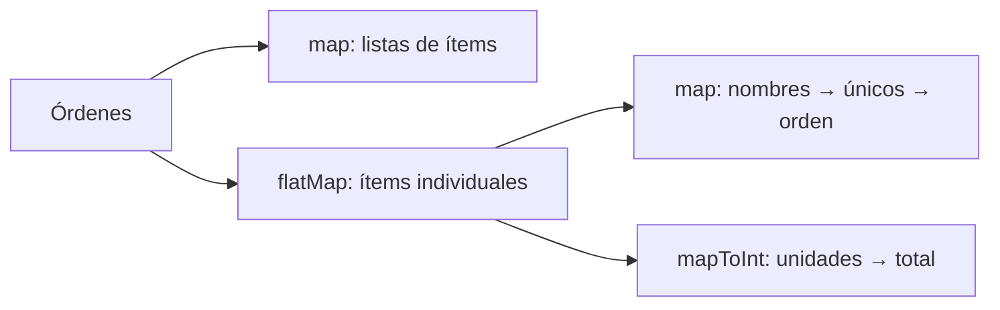
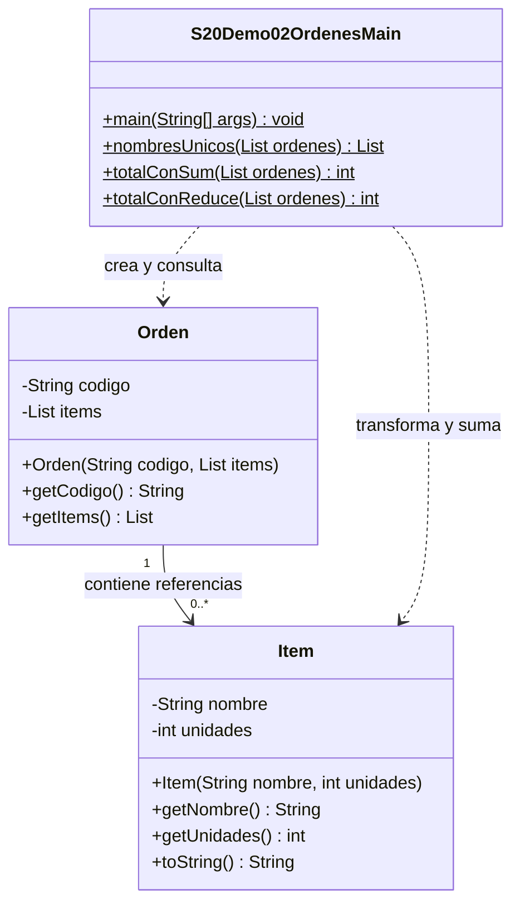

# Demo02 · Órdenes e ítems · 20 minutos

**Problema:** cada orden contiene una lista de ítems. Necesitamos un catálogo de nombres únicos y el total de unidades, sin perder ventas repetidas.

## Ejecutar

Usa JDK 17/21 en IntelliJ y marca únicamente `demo/` de esta sesión como **Sources Root**, no todo el src organizativo del curso. Abre [S20Demo02OrdenesMain.java](S20Demo02OrdenesMain.java) → triángulo junto a main → Run. Sin Maven, teclado, archivos, MySQL ni dependencias externas.

## Datos

| Orden | Ítems: nombre y unidades |
| --- | --- |
| O1 | Cuaderno2, Lapiz3 |
| O2 | Cuaderno1, Borrador4 |
| O3 | Vacía |

Lee [Item](Item.java), [Orden](Orden.java) y el Main. Son las únicas tres clases. Orden conserva una copia no modificable de su lista; los ítems de esta demo no tienen setters.

## Orden de explicación

1. Sigue `map(Orden::getItems)`: cada orden produce **una lista**. Antes de toList fluye Stream<List<Item>>; al finalizar tienes List<List<Item>>. Las listas siguen anidadas.
2. Sigue `flatMap(orden -> orden.getItems().stream())`: reúne los ítems internos en un Stream<Item>. O3 aporta cero elementos. No está filtrando órdenes por estado.
3. En nombresUnicos, map convierte Item en String; distinct elimina nombres repetidos y sorted ordena antes de toList. Espera Borrador,Cuaderno,Lapiz.
4. En totalConSum, mapToInt obtiene las unidades de cada ítem y produce IntStream; sum es la terminal. Espera2+3+1+4=10.
5. En totalConReduce, otro stream vuelve a obtener las unidades; reduce(0,Integer::sum) parte de0 y acumula con suma. También devuelve10.
6. Cada consulta inicia un stream nuevo. No intentes sumar sobre el que ya terminó en una lista.
7. Revisa las órdenes vacías: catálogo[],sum0,reduce0.
8. Cambia Cuaderno de O2 de1 a5: los nombres únicos siguen iguales y ambos totales pasan a14. Restaura1.

## Salida esperada

```text
1. Listas internas: [[Cuaderno:2, Lapiz:3], [Cuaderno:1, Borrador:4], []]
2. Items planos: [Cuaderno:2, Lapiz:3, Cuaderno:1, Borrador:4]
3. Nombres unicos ordenados: [Borrador, Cuaderno, Lapiz]
4. Unidades con sum: 10
5. Unidades con reduce: 10
Original: [[Cuaderno:2, Lapiz:3], [Cuaderno:1, Borrador:4], []]
Todas vacias: []
Suma vacia: 0
Reduccion vacia: 0
```

## Diferencias que debes explicar

- map transforma cada elemento; flatMap reúne cero o más elementos internos en un solo flujo.
- Deduplicamos **String**: distinct usa igualdad. No damos por hecho que dos objetos Item con el mismo nombre sean iguales.
- **No apliques distinct a las unidades antes de sumar:** una cantidad repetida puede corresponder a ventas distintas.
- mapToInt no es terminal. sum y reduce sí producen el resultado.
- Para sumar, sum es directo; reduce permite expresar una combinación general. Aquí0 es identidad y suma es asociativa; no se puede reemplazar por cualquier operación y esperar el mismo comportamiento.
- Los datos son pequeños; int puede desbordar con cantidades fuera de este ejercicio. No se usa un acumulador externo mutable desde forEach.
- No cerramos estos streams como archivos: las fuentes en memoria no mantienen un recurso de I/O abierto.

En Debug, detente en la lambda de flatMap y observa la lista interna de cada orden. No necesitamos peek para producir resultados.

## Forma de los datos



## UML

Main utiliza Orden e Item. La relación Orden–Item guarda referencias en una lista; no exige un ciclo de vida exclusivo, por eso no se representa como composición.



[Volver a la sesión](../../README.md)
